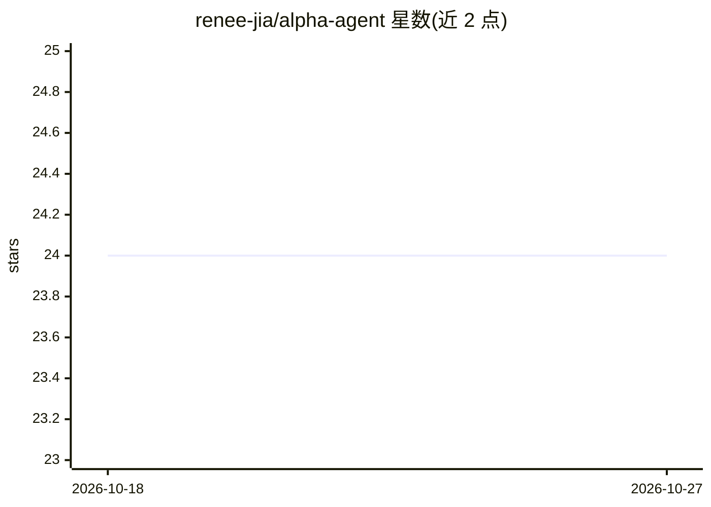

# renee-jia/alpha-agent

⭐ 24 · Python · 推送 2026-03-06 · [GitHub](https://github.com/renee-jia/alpha-agent) · 个人维护

**多 agent 量化交易平台：股票期权信号生成与回测**

面向量化交易开发者与研究者的多 agent 交易系统：数据、预测、交易、风控、情绪分析等专职 agent 通过受 metaGPT 启发的通信协议协作，结合 LSTM/XGBoost/Prophet 模型与 101 alpha 因子选股，为股票与期权生成交易信号。集成 Polygon.io 获取实时与历史行情，提供 Black-Scholes 定价、期权策略生成与回测框架（含 Sharpe/最大回撤等指标）。通过 git clone 源码安装，配置 config.yaml 定制参数。

## 筛选速览

| 维度 | 判定 | 备注 |
|---|---|---|
| AI 角色 | `ai-native` | 本体是模型或模型工具 |
| 许可风险 | `none` | — |
| 部署形态 | `None` |  |
| 模型依赖 | — | README 未给出锁定关系 |
| 硬件要求 | — | 无带数字的原话,不猜 |
| 安装摩擦 | `low` | 无编译、无系统依赖或容器化 |
| 成熟度 | — | 结构信号不足 |

## 能力要点

- 数据/预测/交易/风控/情绪五类专职 agent 协作
- 101 alpha 因子实现与动态评估（IC/换手率/半衰期）
- LSTM/XGBoost/Prophet 价格预测模型
- 回测框架含收益率/Sharpe/Sortino/最大回撤指标

## 适用场景

- 研究多 agent 架构下的量化交易信号生成
- 评估自定义 alpha 因子的有效性
- 对期权策略进行历史回测

## 场景标签

`多智能体` `金融量化` · 领域:Agent 开发

## 证据(README 行号)

> L4: Alpha-Agent is a sophisticated multi-agent trading system that leverages machine learning, alpha factor selection, a
> L10: - **Machine Learning Models**: LSTM, XGBoost, and Prophet models for price prediction

## 星数曲线

2026-10-18 24 → 2026-10-27 24（+0）

---
*卡片 v1 · prompt 1.4 · 生成 2026-10-27 · 置信度 high · 依据 README sha `2d0d65dcaa1f` · [字段定义](../../DATASET.md)*
