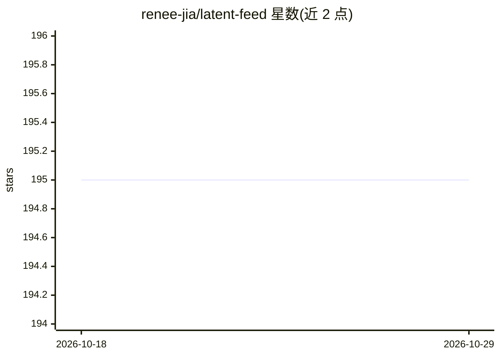

# renee-jia/latent-feed

⭐ 195 · Python · 推送 2026-03-21 · [GitHub](https://github.com/renee-jia/latent-feed) · 个人维护

**每日 AI 资讯聚合工具：抓取多源内容生成摘要送入 Obsidian 或邮箱**

Python 脚本工具，每日从 ArXiv、OpenAI/Anthropic/Karpathy 博客、GitHub Trending、Hacker News、Papers with Code、Reddit 六类来源抓取内容，按关键词过滤并自动归入 10 个类别，生成一份 digest 写入 Obsidian 日记或通过 SMTP 发送邮件。可选开启基于 Claude API（ANTHROPIC_API_KEY）的条目摘要。支持自定义 RSS 源、cron 定时与 GitHub Actions 运行；不开启摘要时无需任何 API key，也无需模型调用。

## 筛选速览

| 维度 | 判定 | 备注 |
|---|---|---|
| AI 角色 | `ai-enhanced` | 去掉 AI 部分产品仍成立 |
| 许可风险 | `permissive` | — |
| 部署形态 | `library` | 以包/库形式分发 |
| 模型依赖 | — | README 未给出锁定关系 |
| 硬件要求 | — | 无带数字的原话,不猜 |
| 安装摩擦 | `low` | 无编译、无系统依赖或容器化 |
| 成熟度 | — | 结构信号不足 |

## 能力要点

- 六类来源聚合，配置中可逐项开关，支持自定义 RSS
- 条目自动归类到 10 个 AI 主题类别（关键词可编辑）
- 输出到 Obsidian 日记文件夹或 SMTP 邮件订阅
- 摘要功能为可选项，通过 ANTHROPIC_API_KEY 调用 Claude

## 适用场景

- 每天早上在 Obsidian 中获得一份按主题分类的 AI 资讯日报
- 用关键词过滤只跟踪自己关心的 LLM 研究与开源项目动态
- 通过邮件订阅方式把日报发给团队成员

## 场景标签

`网页抓取` `AI 写作` · 领域:效率与自动化

## 证据(README 行号)

> L24: **Features:** Run once a day · Clean digest by topic · Write to Obsidian or email
> L117: ### 3️⃣ Optional: Turn on summaries
> L122: export ANTHROPIC_API_KEY="your-api-key"

## 星数曲线

2026-10-18 195 → 2026-10-29 195（+0）

---
*卡片 v1 · prompt 1.4 · 生成 2026-10-22 · 置信度 mid · 依据 README sha `165121aad908` · [字段定义](../../DATASET.md)*
