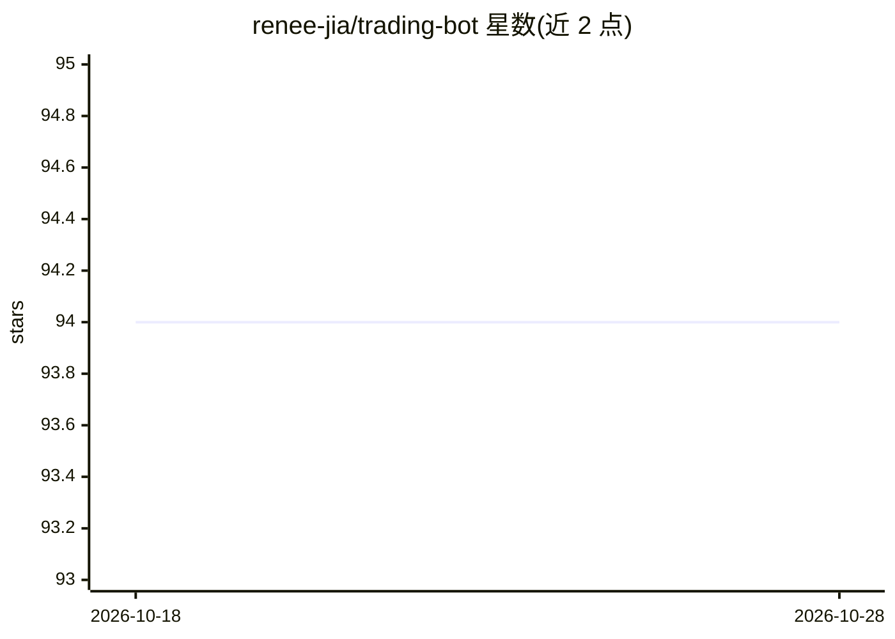

# renee-jia/trading-bot

⭐ 94 · Python · NOASSERTION · 推送 2026-10-07 · [GitHub](https://github.com/renee-jia/trading-bot) · 个人维护

**多因子选股与动量组合的宏观交易机器人，接入 Alpaca 实盘**

Python 编写的量化交易系统：多个分析模块（技术、趋势、宏观、情绪、量化 alpha）对股票生成 0–100 评分，按 6 个月动量构建 top-10 组合，支持 T+1 回测（对比 SPY/QQQ）与 Alpaca paper 实盘执行；另有一层 Claude 研究代理丰富宏观视角。关键限制：30 个 alpha 因子、评分器与仓位引擎位于私有 core/ 包，本仓库不包含，缺少它无法端到端运行。部署方式含 GCP Cloud Run 定时任务与 Docker 镜像。仅供研究与教育用途。

## 筛选速览

| 维度 | 判定 | 备注 |
|---|---|---|
| AI 角色 | `ai-enhanced` | 去掉 AI 部分产品仍成立 |
| 许可风险 | `none` | NOASSERTION |
| 部署形态 | `self-host` | docker 或自建部署 |
| 模型依赖 | locked-api |  |
| 硬件要求 | — | 无带数字的原话,不猜 |
| 安装摩擦 | `low` | 无编译、无系统依赖或容器化 |
| 成熟度 | — | 结构信号不足 |

## 能力要点

- 技术/趋势/alpha/情绪多模块加权生成 0–100 评分并映射买卖建议
- 动量 top-10 组合 + 波动率目标（40%）与宏观现金储备
- Claude 研究代理（.claude/skills/）丰富宏观分析
- 提供 Alpaca paper 账户实盘跟踪与逐年回测结果

## 适用场景

- 量化研究者复用开源 harness 搭建选股与回测流程
- 接入 Alpaca paper 账户做自动化交易实验
- 对比自建策略与 S&P 500/Nasdaq-100 的逐年表现

## 场景标签

`金融量化` · 领域:学习与行业

## 证据(README 行号)

> L3: **A macro buy-and-hold engine that orchestrates a team of specialized analysis agents — technical, trend, macro, sen
> L49: **Plus a layer of Claude research agents** (in `.claude/skills/`) that enrich the macro view — `market-news-analyst
> L59: |🔒 Alpha|20%|30 quantitative factors (WorldQuant-style)|

## 星数曲线

2026-10-18 94 → 2026-10-28 94（+0）

---
*卡片 v1 · prompt 1.4 · 生成 2026-10-23 · 置信度 mid · 依据 README sha `f6f4ebbb9913` · [字段定义](../../DATASET.md)*
