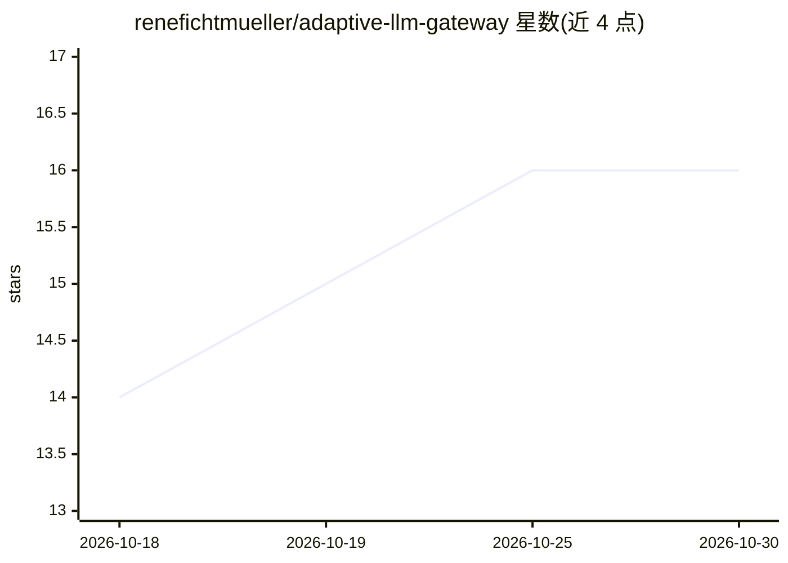

# renefichtmueller/adaptive-llm-gateway

⭐ 16 · TypeScript · Apache-2.0 · 推送 2026-10-29 · [GitHub](https://github.com/renefichtmueller/adaptive-llm-gateway) · 个人维护

**把包月 AI 订阅 CLI 转成统一 OpenAI/Anthropic 兼容 API 的自托管网关**

自托管 LLM 网关（TypeScript/Node 20+/Fastify），面向已订阅 Claude Code Max、ChatGPT Plus、Copilot、Gemini 等包月服务的个人开发者与小团队：自动发现本机已装的订阅 CLI 并封装为本地 HTTP 桥，暴露 OpenAI 与 Anthropic 兼容端点。内置提示注入防御（OWASP LLM-01 模式）、10 类 PII 脱敏与回填、统一订阅额度钱包、成本感知自适应路由、语义缓存、推理轨迹拆分、时间旅行回放与 MCP server 模式。作者自述处于 v0.3 实验阶段，未做企业规模压力测试，API 在 v1.0 前可能变动。

## 筛选速览

| 维度 | 判定 | 备注 |
|---|---|---|
| AI 角色 | `ai-ecosystem` | LLM/agent 周边工具 |
| 许可风险 | `permissive` | Apache-2.0 |
| 部署形态 | `self-host` | docker 或自建部署 |
| 模型依赖 | local-ok | 支持本地模型 |
| 硬件要求 | — | 无带数字的原话,不猜 |
| 安装摩擦 | `low` | 无编译、无系统依赖或容器化 |
| 成熟度 | `idea` | |

## 能力要点

- 8 个订阅 CLI 桥接 + 统一订阅钱包（按真实订阅共享配额池）
- 提示注入防御（20+ 双语模式）与 PII 脱敏/回填（10 类，GDPR/HIPAA 友好）
- OpenAI/Anthropic 兼容端点 + MCP server 模式（HTTP+SSE+stdio）
- 成本感知自适应路由、语义缓存、时间旅行回放、多模型竞速

## 适用场景

- 把多个包月 AI 订阅聚合成一个统一 API 供 IDE 插件和 agent 框架调用
- 受监管环境中使用云端 LLM 前做 PII 脱敏与注入防护
- 跨多个模型按成功率与成本自适应路由并追踪额度消耗

## 场景标签

`模型网关` · 领域:Agent 开发

## 证据(README 行号)

> L20: **The Adaptive LLM Gateway is different.** It auto-discovers everything installed on your machine, wraps each subsc
> L202: |Method|Path|Compatible with|
> L204: |`POST`|`/v1/chat/completions`|OpenAI `chat.completions.create` (streaming + tools)|

## 星数曲线

2026-10-18 14 → 2026-10-30 16（+2）

---
*卡片 v1 · prompt 1.4 · 生成 2026-10-30 · 置信度 high · 依据 README sha `9a7238838460` · [字段定义](../../DATASET.md)*
