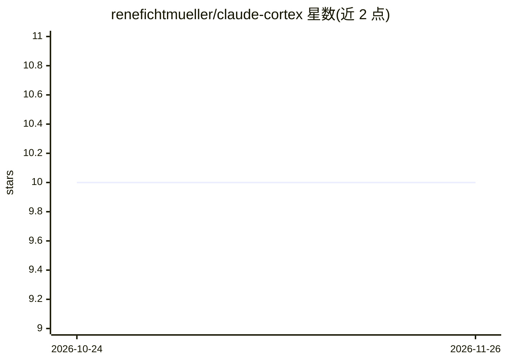

# renefichtmueller/claude-cortex

⭐ 10 · Shell · MIT · 推送 2026-06-24 · [GitHub](https://github.com/renefichtmueller/claude-cortex) · [官网](https://claude-cortex-demo.pages.dev) · 个人维护

**给 Claude Code 加跨会话持久记忆的 Markdown 文件框架**

claude-cortex 是一个基于文件的 Claude Code 持久记忆框架：用 MEMORY.md 主索引加 activity-log、project、incident、integration、feedback、reference 等 Markdown 模板构成层级知识库，通过 CLAUDE.md 指令让 Claude 在会话开始读取、结束更新记忆，无需数据库、服务器或 API key。附 npx 初始化命令、init/sync/validate/stats 脚本、健康检查及两个示例工程，记忆文件可经 Dropbox/iCloud/Git 跨设备同步。

## 筛选速览

| 维度 | 判定 | 备注 |
|---|---|---|
| AI 角色 | `ai-ecosystem` | LLM/agent 周边工具 |
| 许可风险 | `permissive` | MIT |
| 部署形态 | `library` | 以包/库形式分发 |
| 模型依赖 | — | README 未给出锁定关系 |
| 硬件要求 | — | 无带数字的原话,不猜 |
| 安装摩擦 | `low` | 无编译、无系统依赖或容器化 |
| 成熟度 | — | 结构信号不足 |

## 能力要点

- MEMORY.md 主索引（限 200 行）+ 7 类主题模板的层级结构
- 由 CLAUDE.md 指令驱动，无数据库、无服务器、无 API key
- 提供 init/sync/validate/stats 脚本做结构校验与统计
- npx claude-cortex init 一条命令初始化项目记忆目录

## 适用场景

- 新会话让 Claude Code 直接恢复项目上下文，不用重复解释
- 沉淀 bug 修复过程为 incident runbook，避免重复排查
- 跨项目共享代码偏好与架构决策记录
- 多台设备间同步同一份项目知识库

## 场景标签

`Agent 记忆` `知识库管理` · 领域:Agent 开发

## 证据(README 行号)

> L33: **claude-cortex** is a structured, file-based persistent memory framework that gives Claude Code long-term memory a
> L35: It uses a hierarchy of Markdown files that Claude reads at session start and updates at session end. No database. N
> L145: The files don't update themselves — Claude updates them because your `CLAUDE.md` **instructs** it to. The template

## 星数曲线

2026-10-24 10 → 2026-11-26 10（+0）

---
*卡片 v1 · prompt 1.4 · 生成 2026-11-19 · 置信度 high · 依据 README sha `3aad7c2c61bf` · [字段定义](../../DATASET.md)*
