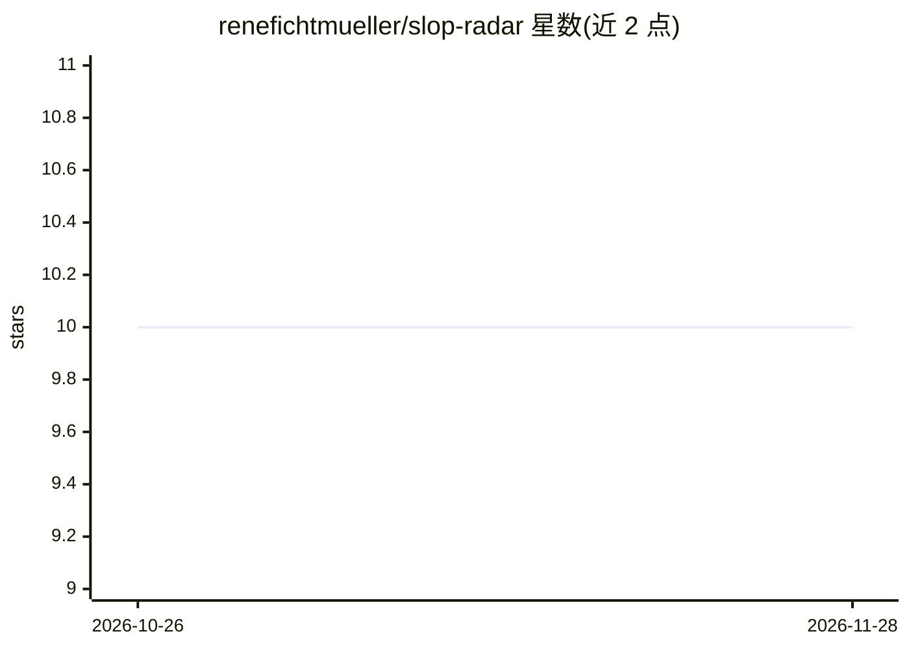

# renefichtmueller/slop-radar

⭐ 10 · TypeScript · MIT · 推送 2026-10-03 · [GitHub](https://github.com/renefichtmueller/slop-radar) · [官网](https://slop-radar-demo.pages.dev) · 个人维护

**检测英德文本中 AI 风格写作并给出 0-100 分的 linter**

以 CLI 与 Node.js 库形式运行的文本检测工具：基于 437 条英语、210 条德语短语库与 16 种结构模式，对文本做大小写、变音符号、屈折变化等模糊匹配，按扣分规则计算 0-100 分并分级（HUMAN 至 PURE SLOP）。不判定文本作者是否为模型，只测量 AI 风格写作特征。提供浏览器在线演示、JSON 输出供 CI 使用，并附带 Claude Code / Codex 的 agent skill 安装文件。需 Node.js 18+。

## 筛选速览

| 维度 | 判定 | 备注 |
|---|---|---|
| AI 角色 | `ai-native` | 本体是模型或模型工具 |
| 许可风险 | `permissive` | MIT |
| 部署形态 | `library` | 以包/库形式分发 |
| 模型依赖 | — | README 未给出锁定关系 |
| 硬件要求 | — | 无带数字的原话,不猜 |
| 安装摩擦 | `low` | 无编译、无系统依赖或容器化 |
| 成熟度 | — | 结构信号不足 |

## 能力要点

- 英德双语 647 条短语库与 16 种结构模式检测
- 0-100 评分规则透明（扣分/加分规则逐条公开）
- npm CLI、Node.js 库、浏览器静态演示三种使用形态
- 附 Claude Code 与 OpenAI Codex 的 agent skill

## 适用场景

- 发布前检查自己的稿件是否有 AI 腔
- 在 CI 中对仓库文案强制执行写作标准
- 给 AI 生成的草稿打分并据此改写
- 处理德语文案时做同样的风格检查

## 场景标签

 · 领域:写作/文本质量检测工具

## 证据(README 行号)

> L3: **Find AI slop in English and German text.** slop-radar flags the buzzwords, filler phrases and formatting habits th
> L12: slop-radar does not try to prove who wrote a text. It measures **AI-style writing**: the phrases and structures tha
> L61: slop-radar json draft.md             # machine-readable JSON, e.g. for CI

## 星数曲线

2026-10-26 10 → 2026-11-28 10（+0）

---
*卡片 v1 · prompt 1.4 · 生成 2026-11-19 · 置信度 high · 依据 README sha `ecacaeda40a6` · [字段定义](../../DATASET.md)*
