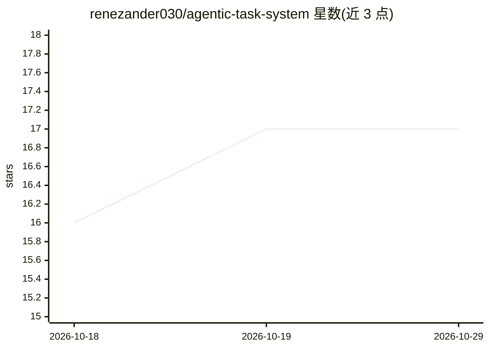

# renezander030/agentic-task-system

⭐ 17 · JavaScript · MIT · 推送 2026-10-25 · [GitHub](https://github.com/renezander030/agentic-task-system) · [官网](https://www.npmjs.com/package/@reneza/ats-cli) · 个人维护

**给 AI agent 的任务上下文层：MCP 服务 + CLI，覆盖 TickTick/Notion/GitHub 等**

MCP server 与 CLI，把 TickTick、Notion、GitHub、Obsidian、Airtable 等既有任务系统映射为统一任务契约，供 Claude Code、Cursor 等 MCP 客户端读写：ats find 用 RRF 融合关键词/原生/可选稠密检索分支并保留溯源，写入支持 if-match、幂等与 undo。后端始终保持权威，缓存与向量索引仅为派生态。另有 ats kg 知识图谱层：agent 提出三元组事实，人工批准后写入，无 LLM、无图数据库服务器即可运行，可导出 LadybugDB/Neo4j/FalkorDB/Graphiti。以 npm 全局安装，凭据留在 adapter 边界。

## 筛选速览

| 维度 | 判定 | 备注 |
|---|---|---|
| AI 角色 | `ai-ecosystem` | LLM/agent 周边工具 |
| 许可风险 | `permissive` | MIT |
| 部署形态 | `library` | 以包/库形式分发 |
| 模型依赖 | local-ok | 支持本地模型 |
| 硬件要求 | — | 无带数字的原话,不猜 |
| 安装摩擦 | `low` | 无编译、无系统依赖或容器化 |
| 成熟度 | — | 结构信号不足 |

## 能力要点

- RRF 融合多源检索（关键词/原生/稠密）并保留 provenance
- 写入支持 --if-match 内容哈希、幂等键与 undo 回滚
- ats kg 知识图谱层：agent 提案、人工批准、确定性词法评分应答、无 LLM 依赖
- kg 可导出 LadybugDB/Neo4j/FalkorDB/Graphiti 格式

## 适用场景

- 让编码 agent 读写我现有 TickTick/Notion/GitHub 里的任务与决策
- 跨多个任务系统做一次带溯源的统一检索
- 把 agent 会话中产生的 durable 事实沉淀为人工批准的知识图谱

## 场景标签

`Agent 记忆` `知识图谱` `语义搜索` · 领域:Agent 开发

## 证据(README 行号)

> L10: `ats` is an **MCP server and CLI that keeps AI-agent context in the task systems you already maintain** — TickTick,
> L14: **Two layers, one CLI: tasks and a knowledge graph.** The task layer is record-based on purpose — every entry lives

## 星数曲线

2026-10-18 16 → 2026-10-29 17（+1）

---
*卡片 v1 · prompt 1.4 · 生成 2026-10-29 · 置信度 high · 依据 README sha `96b11c2ca10f` · [字段定义](../../DATASET.md)*
