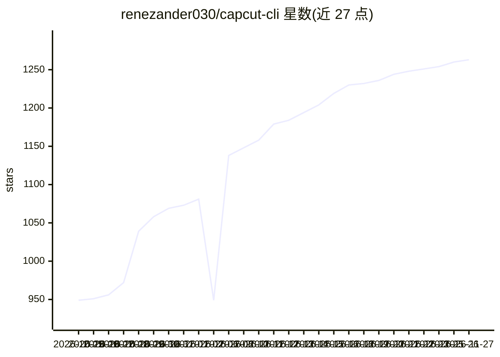

# renezander030/capcut-cli

⭐ 1,263 · JavaScript · MIT · 推送 2026-11-24 · [GitHub](https://github.com/renezander030/capcut-cli) · [官网](https://renezander.com/projects/capcut-cli) · 个人维护

**供剪辑者和 LLM agent 终端操作 CapCut/剪映草稿的 CLI**

独立非官方的 Node CLI，直接读写本地 CapCut/剪映草稿（draft_content.json 等），零依赖、无服务器与 API，输出仍可在 CapCut 中编辑。功能覆盖字幕导入导出、配音、翻译、剪辑/速度/转场/蒙版、模板预设、长视频切短片等。可用作 CLI、typed 库、JSONL 队列运行器（对接 n8n/Make/Coze），并提供面向 agent 的技能安装器与实验性只读 Wasm MCP 工具。需 Node ≥18，caption/render 等命令依赖可选的 Whisper/FFmpeg。

## 筛选速览

| 维度 | 判定 | 备注 |
|---|---|---|
| AI 角色 | `ai-enhanced` | 去掉 AI 部分产品仍成立 |
| 许可风险 | `permissive` | MIT |
| 部署形态 | `desktop` | 安装包/桌面程序 |
| 模型依赖 | — | README 未给出锁定关系 |
| 硬件要求 | — | 无带数字的原话,不猜 |
| 安装摩擦 | `medium` | 含编译或系统依赖之一 |
| 成熟度 | — | 结构信号不足 |

## 能力要点

- 直接读写本地草稿 JSON，无需上传、API 或 MCP 服务器
- 一条命令向 Claude Code/Codex/Cursor 等安装 capcut-edit 技能
- 四种用法：CLI、typed 库、JSONL 队列运行器、实验性只读 Wasm MCP 工具
- 支持字幕/配音/翻译、模板预设与长视频切短片等命令组

## 适用场景

- 让 LLM agent 批量给视频加字幕并输出可继续编辑的剪映草稿
- 把长视频自动切成带样式字幕的短片初稿
- 在 n8n/Make/Coze 流水线里通过 JSONL 任务批量处理草稿

## 场景标签

`图像视频处理` · 领域:感知与多模态

## 证据(README 行号)

> L13: **Create and edit real CapCut / JianYing projects from the terminal — or any LLM agent.**
> L92: **An independent CLI for CapCut / JianYing that any LLM agent can drive — zero dependencies, no server, both namesp
> L103: ### Give your agent the skill

## 星数曲线

2026-10-25 949 → 2026-11-27 1,263（+314）

---
*卡片 v1 · prompt 1.4 · 生成 2026-11-25 · 置信度 high · 依据 README sha `df263df3c300` · [字段定义](../../DATASET.md)*
