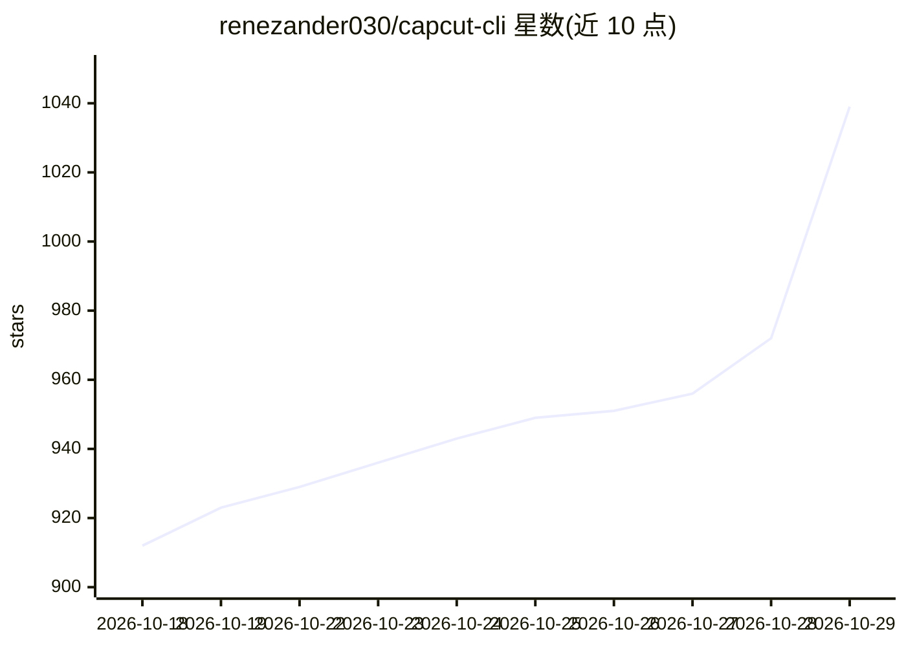

# renezander030/capcut-cli

⭐ 1,039 · JavaScript · MIT · 推送 2026-10-25 · [GitHub](https://github.com/renezander030/capcut-cli) · [官网](https://renezander.com/projects/capcut-cli) · 个人维护 · 中文 README

**LLM agent 可调用的 CapCut/剪映草稿本地编辑 CLI**

独立非官方的 Node.js 命令行工具，直接读写本地 CapCut/JianYing 草稿 JSON（draft_content.json 等），完成字幕、剪辑、变速、音量、模板、长转短等编辑，输出仍可在剪映/CapCut 中继续编辑的可编辑轨道，无需上传、API 或服务端。设计上面向 LLM agent 驱动：提供 agent skill 安装、Claude Code 插件、无外部能力的只读 Wasm 工具（inspect/diff/lint-portable）及 JSONL 队列 runner。可选配合 Whisper（字幕）、FFmpeg（渲染）与 ANTHROPIC_API_KEY（翻译）。剪映/CapCut 为字节跳动商标，项目与其无关联；Wasm 沙箱与 agent sandbox 标注为实验性。

## 筛选速览

| 维度 | 判定 | 备注 |
|---|---|---|
| AI 角色 | `ai-enhanced` | 去掉 AI 部分产品仍成立 |
| 许可风险 | `permissive` | MIT |
| 部署形态 | `library` | 以包/库形式分发 |
| 模型依赖 | — | README 未给出锁定关系 |
| 硬件要求 | — | 无带数字的原话,不猜 |
| 安装摩擦 | `medium` | 含编译或系统依赖之一 |
| 成熟度 | — | 结构信号不足 |

## 能力要点

- 直接读写本地草稿 JSON，JSON 进 JSON 出，原子写入并留 .bak
- npx skills add 一条命令向 Claude Code 等安装 capcut-edit 技能
- 零依赖 Wasm 只读工具供 agent 安全检查草稿（实验性）
- 长视频转短视频：detect-scenes / detect-silence / detect-retakes / cut

## 适用场景

- 让 AI agent 按草稿 JSON 边界自动加字幕、剪辑、套模板
- 批量把长视频切成短视频并生成可继续编辑的剪映草稿
- 自动化流水线（n8n/Make/Coze）通过 JSONL 队列驱动剪辑

## 场景标签

`图像视频处理` · 领域:感知与多模态

## 证据(README 行号)

> L13: **Create and edit real CapCut / JianYing projects from the terminal — or any LLM agent.**
> L56: JSON in, JSON out: every command reads and writes the local draft store directly, with no MCP server or HTTP daemon
> L144: CapCut/JianYing store each project as local JSON. capcut-cli loads that store, validates against a version-aware s

## 星数曲线

2026-10-18 912 → 2026-10-29 1,039（+127）

---
*卡片 v1 · prompt 1.4 · 生成 2026-10-21 · 置信度 high · 依据 README sha `2a0988e78639` · [字段定义](../../DATASET.md)*
