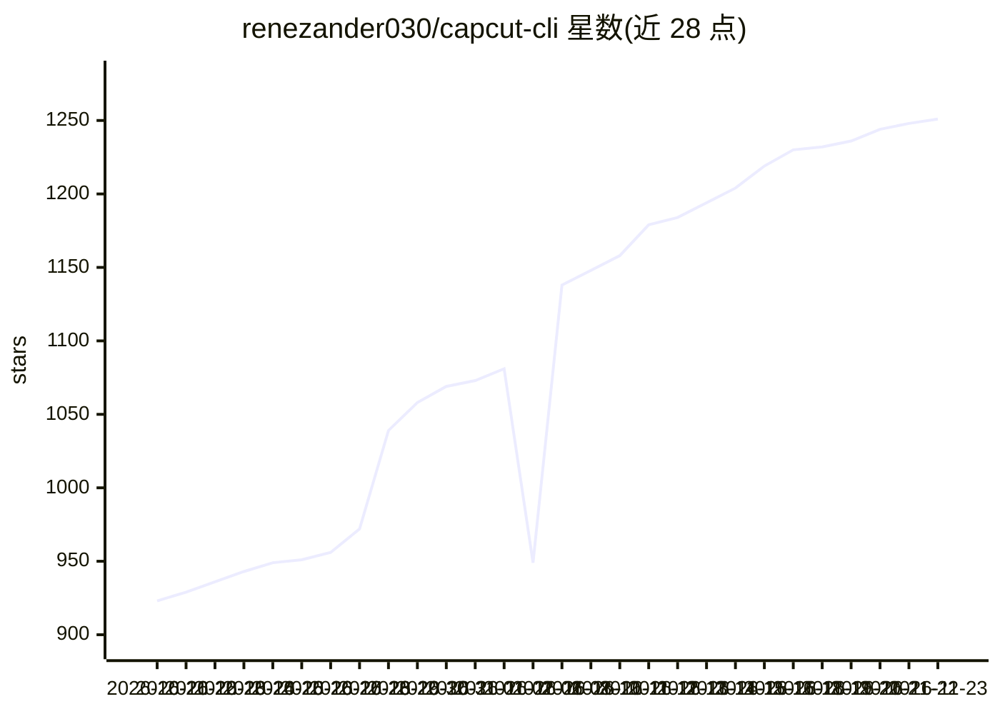

# renezander030/capcut-cli

⭐ 1,251 · TypeScript · MIT · 推送 2026-11-22 · [GitHub](https://github.com/renezander030/capcut-cli) · [官网](https://renezander.com/projects/capcut-cli) · 个人维护 · 中文 README

**CLI 直接编辑 CapCut/剪映草稿，可供 LLM agent 驱动**

非官方独立 CLI，直接读写本地 CapCut/剪映草稿 JSON（draft_content.json 等），无上传、无 API、无 MCP 服务器；命令覆盖字幕导入导出、翻译、剪辑、变速、转场、模板、长视频切条等，输出仍可在 CapCut 中继续编辑。安装方式包括 npm、便携压缩包、Python 包装与源码构建；`caption --cloud` 是唯一外发音频的可选实验功能。维护者声明与 ByteDance 无关联。

## 筛选速览

| 维度 | 判定 | 备注 |
|---|---|---|
| AI 角色 | `ai-enhanced` | 去掉 AI 部分产品仍成立 |
| 许可风险 | `permissive` | MIT |
| 部署形态 | `library` | 以包/库形式分发 |
| 模型依赖 | — | README 未给出锁定关系 |
| 硬件要求 | — | 无带数字的原话,不猜 |
| 安装摩擦 | `medium` | 含编译或系统依赖之一 |
| 成熟度 | — | 结构信号不足 |

## 能力要点

- 直接读写本地草稿 JSON，零依赖、无服务器
- 四类用法：CLI、TypeScript 库、JSONL 队列 runner、实验性 Wasm 只读工具
- 一条命令向 Claude Code/Codex/Cursor 等安装 capcut-edit 技能
- 支持中英日三语文档与 `--jianying` 剪映命名空间

## 适用场景

- 从终端批量剪辑视频并生成可继续编辑的 CapCut 工程
- 让 LLM agent 检查、构建草稿或切长视频为短片
- 导入 SRT 字幕并克隆多语言版本草稿
- 自动化流水线（n8n/Make/Coze）通过 serve 队列处理剪辑任务

## 场景标签

`工作流自动化` · 领域:效率与自动化

## 证据(README 行号)

> L1: capcut-cli — the CapCut/JianYing CLI any LLM agent can drive: zero dependencies, no server, both namespaces
> L13: **Create and edit real CapCut / JianYing projects from the terminal — or any LLM agent.**
> L87: - **CLI** — `npm install -g capcut-cli`, then `capcut <command> <project>`
> L94: One command installs the `capcut-edit` skill into Claude Code, Codex, Cursor, OpenCode and the other agents the `sk

## 星数曲线

2026-10-21 923 → 2026-11-23 1,251（+328）

---
*卡片 v1 · prompt 1.4 · 生成 2026-11-23 · 置信度 high · 依据 README sha `3866490533a6` · [字段定义](../../DATASET.md)*
