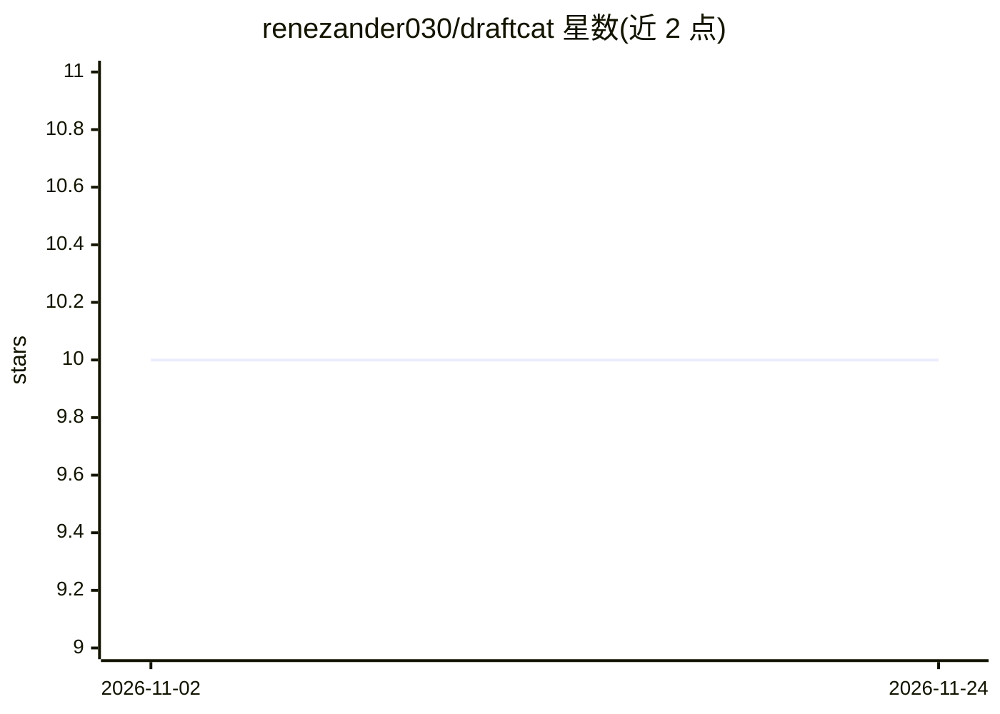

# renezander030/draftcat

⭐ 10 · Go · MIT · 推送 2026-11-23 · [GitHub](https://github.com/renezander030/draftcat) · 个人维护

**为服务型企业提供含人工审批门的治理式 AI 流水线**

单个 Go 二进制、自托管的治理层：以 YAML 定义流水线执行邮件分诊、线索资格判定、回复起草、PDF 数据抽取等任务，但 LLM 无法直接触发对外动作——每个外发动作须经操作员审批门，每次模型调用受 token/成本预算约束，状态与去重由 SQLite 存储支撑。另含实验性 FHE 加密投票计数与 Groth16 零知识审批证明，作者声明二者非生产合规承诺、电路未经独立审计。每个实例服务一个业务。

## 筛选速览

| 维度 | 判定 | 备注 |
|---|---|---|
| AI 角色 | `ai-ecosystem` | LLM/agent 周边工具 |
| 许可风险 | `permissive` | MIT |
| 部署形态 | `self-host` | docker 或自建部署 |
| 模型依赖 | — | README 未给出锁定关系 |
| 硬件要求 | — | 无带数字的原话,不猜 |
| 安装摩擦 | `low` | 无编译、无系统依赖或容器化 |
| 成熟度 | `idea` | |

## 能力要点

- 每个外发动作的强制人工审批门（consume-once tool permits、durable gate）
- per-step/pipeline/day 的 token 与成本预算，超限即停
- 模型输入输出策略：注入模式清洗与 output_schema 校验
- 版本化审批/动作回执，可导出 JSONL 离线验证

## 适用场景

- AI 起草的客服回复须人工批准后才发给客户
- 为自托管 agent/CLI 工具的每个 MCP 调用加审批门
- 委员会投票时计票方不可见个人投票内容
- 向客户或审计方证明某 AI 动作经人工批准而不泄露数据

## 场景标签

`工作流自动化` · 领域:效率与自动化

## 证据(README 行号)

> L3:  Governed AI pipelines where the LLM can't fire actions — one Go binary, self-hosted, human-in-the-loop.
> L13: Draftcat runs YAML-defined pipelines that triage email, qualify leads, draft replies, extract data from PDFs, and g
> L77: However your agent runs, draftcat sits between it and your customer systems as a **mandatory approval gate** — not 

## 星数曲线

2026-11-02 10 → 2026-11-24 10（+0）

---
*卡片 v1 · prompt 1.4 · 生成 2026-11-19 · 置信度 high · 依据 README sha `6c432a868171` · [字段定义](../../DATASET.md)*
