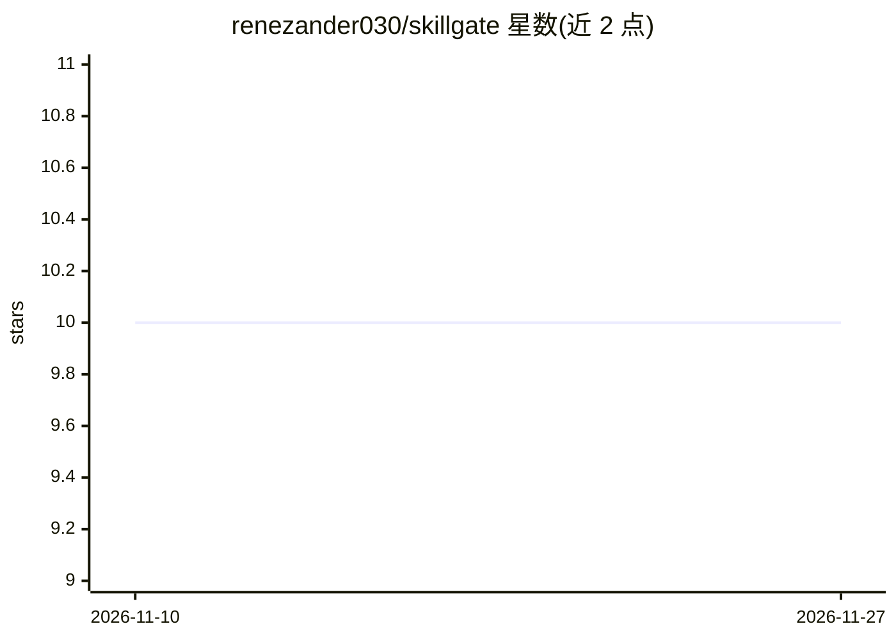

# renezander030/skillgate

⭐ 10 · TypeScript · MIT · 推送 2026-11-24 · [GitHub](https://github.com/renezander030/skillgate) · [官网](https://www.npmjs.com/package/@reneza/skillgate) · 个人维护

**给 AI 编码代理加确定性完成门禁的 CLI：不通过不许提交**

skillgate 是运行在模型之外的确定性评估器：以 .skillgate/done.yaml 定义完成标准，在 commit/push/publish 触发点运行文件系统检查（测试通过、无遗留 TODO、无泄漏密钥等），门禁未通过则拒绝提交。声明评估环节无模型参与，同一输入产生同一判定。提供 npx 零安装审计、npm 项目安装、Docker 容器运行、VPS 服务端钩子四种部署路径，并可一键接入 Claude Code/Codex/Copilot CLI/opencode 等代理钩子。附加实验性的加密聚合指标与零知识通过证明功能，二者声明未经独立安全审计。

## 筛选速览

| 维度 | 判定 | 备注 |
|---|---|---|
| AI 角色 | `ai-ecosystem` | LLM/agent 周边工具 |
| 许可风险 | `permissive` | MIT |
| 部署形态 | `desktop` | 安装包/桌面程序 |
| 模型依赖 | — | README 未给出锁定关系 |
| 硬件要求 | — | 无带数字的原话,不猜 |
| 安装摩擦 | `low` | 无编译、无系统依赖或容器化 |
| 成熟度 | — | 结构信号不足 |

## 能力要点

- 模型外确定性评估器，声明门禁引擎独立于所接入的模型
- 一套 .skillgate/done.yaml 在本地钩子、pre-commit、CI、VPS 服务端统一执行
- skillgate install claude-code/codex/copilot-cli 一键写入代理钩子，fail-closed 设计
- 实验性 FHE 加密聚合指标与 BBS 选择性披露零知识通过证明

## 适用场景

- 防止 AI 编码代理绕过流程直接提交未完成的工作
- 在 CI 与服务端钩子上对私有仓库强制执行完成标准
- 向客户证明私有仓库通过了约定的完成标准而不暴露源码
- 多私有仓库汇总一个不可读出单个仓库结果的质量指标

## 场景标签

 · 领域:开发者工具/AI 代理流程管控

## 证据(README 行号)

> L10: > **A finish-line gate your agent cannot talk its way past.** AI coding agents deviate from your process to reach "
> L87: The default filesystem checks produce the same verdict for the same inputs, with
> L109: Pick the path that matches how far you want the guarantee to reach. Every one enforces the *same* `.skillgate/done

## 星数曲线

2026-11-10 10 → 2026-11-27 10（+0）

---
*卡片 v1 · prompt 1.4 · 生成 2026-11-19 · 置信度 high · 依据 README sha `89221d55a5a9` · [字段定义](../../DATASET.md)*
