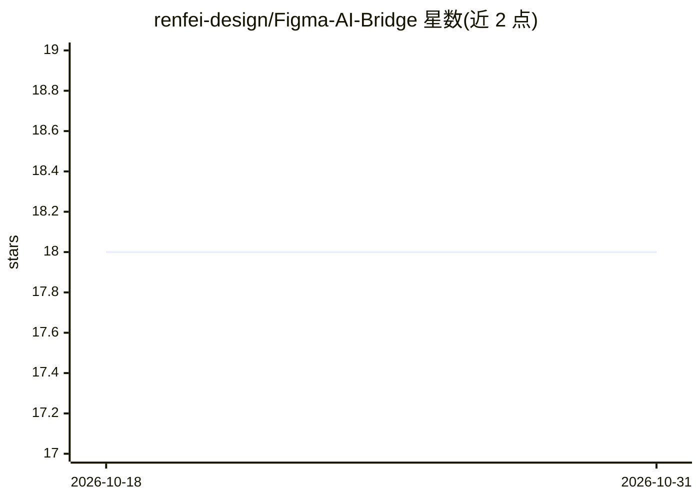

# renfei-design/Figma-AI-Bridge

⭐ 18 · JavaScript · MIT · 推送 2026-02-28 · [GitHub](https://github.com/renfei-design/Figma-AI-Bridge) · 个人维护

**让 AI 助手通过 MCP 实时控制 Figma 的插件+服务器桥接**

由 Figma 插件、Node.js MCP 服务器、WebSocket 中继（端口 3055）组成的桥接系统：在 VS Code 中通过 MCP 让 GitHub Copilot 等助手直接读写 Figma 文档。提供 60 余个工具覆盖创建/编辑/导出节点、批量幻灯片生成、文档页构建、流程图绘制与设计令牌变量绑定；另附 6 个技能（SKILL.md）用于无障碍审计、文案审校、在线调研等多步设计任务。需 Figma 桌面端以开发模式导入插件并保持中继运行。

## 筛选速览

| 维度 | 判定 | 备注 |
|---|---|---|
| AI 角色 | `ai-ecosystem` | LLM/agent 周边工具 |
| 许可风险 | `permissive` | MIT |
| 部署形态 | `None` |  |
| 模型依赖 | — | README 未给出锁定关系 |
| 硬件要求 | — | 无带数字的原话,不猜 |
| 安装摩擦 | `low` | 无编译、无系统依赖或容器化 |
| 成熟度 | — | 结构信号不足 |

## 能力要点

- 插件+MCP 服务器+WebSocket 中继的三段式架构
- 60+ 工具覆盖节点创建/编辑/导出与批量操作
- 幻灯片、文档页、流程图等结构化内容生成工具
- 6 个技能实现无障碍审计、文案审校等多步任务

## 适用场景

- 在 VS Code 中用自然语言让 Copilot 直接操作 Figma 画布
- 批量生成演示幻灯片、文档页与流程图
- 扫描并修复 WCAG 2.2 无障碍问题
- 在设计稿中绑定与聚合设计令牌变量

## 场景标签

 · 领域:设计工具/AI 工具接入

## 证据(README 行号)

> L3: Let GitHub Copilot in VS Code control Figma in real-time through MCP (Model Context Protocol).
> L12: AI Assistant  ←stdio→  MCP Server (Node.js)  ←WebSocket→  Relay (port 3055)  ←WebSocket→  Figma Plugin
> L18: |**MCP Server**|`server/`|Defines MCP tools, connects to WebSocket relay on port 3055|

## 星数曲线

2026-10-18 18 → 2026-10-31 18（+0）

---
*卡片 v1 · prompt 1.4 · 生成 2026-10-29 · 置信度 high · 依据 README sha `15872e879b5c` · [字段定义](../../DATASET.md)*
