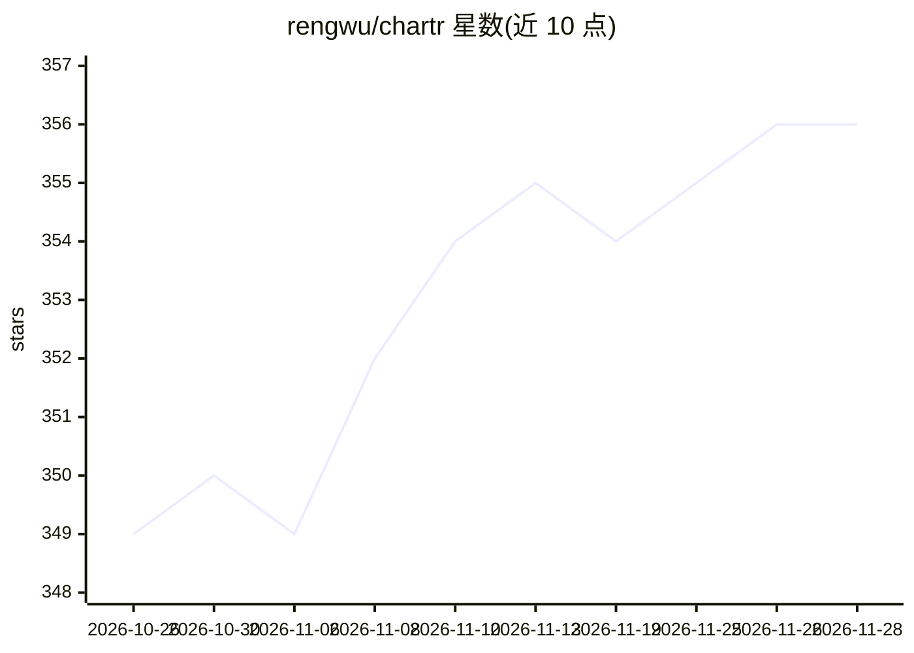

# rengwu/chartr

⭐ 356 · Rust · GPL-3.0 · 推送 2026-11-07 · [GitHub](https://github.com/rengwu/chartr) · [官网](https://chartr.dev) · 个人维护

**面向开发者的终端优先 agentic 工作区，用空间组织终端与 agent**

chartr 是用 Rust 与 GPUI 构建的终端优先 agentic 工作区，将项目组织为 spaces，并在其中并排排列终端标签页、分栏面板与插件工具。会话默认由 Herdr 保持进程存活，退出后可恢复布局；用户可注册已有的 CLI agent 并自定义参数、环境与提示词启动，内置插件支持浏览页面、复用提示词与管理 skills，也可用 HTML/CSS/JavaScript 自建插件，Wayfinder 提供工作地图与按上下文启动 agent。本地运行，无需账号，提供 macOS 与 Linux 的 Rust 版本，许可证为 GPL-3.0-or-later。

## 筛选速览

| 维度 | 判定 | 备注 |
|---|---|---|
| AI 角色 | `ai-ecosystem` | LLM/agent 周边工具 |
| 许可风险 | `viral` | GPL-3.0 |
| 部署形态 | `None` |  |
| 模型依赖 | — | README 未给出锁定关系 |
| 硬件要求 | — | 无带数字的原话,不猜 |
| 安装摩擦 | `low` | 无编译、无系统依赖或容器化 |
| 成熟度 | — | 结构信号不足 |

## 能力要点

- 以文件夹为 spaces 组织终端、工具与 agent，支持标签页与分栏布局
- 注册已有 CLI agent，按自定义参数、环境与提示词启动
- Herdr 保持终端进程存活，重开后恢复会话与布局
- 插件系统支持用 HTML/CSS/JavaScript 自建工具

## 适用场景

- 在同一界面中管理多个项目的终端与 CLI agent
- 为 agent 启动预先准备上下文与提示词
- 退出后恢复终端会话与工作区布局

## 场景标签

 · 领域:开发者工具/终端工作区

## 证据(README 行号)

> L13: Keep your projects, tools, workflows, and agents together. chartr is an
> L35: - **Bring your CLI agents** — Register the agents you already use and launch

## 星数曲线

2026-10-26 349 → 2026-11-28 356（+7）

---
*卡片 v1 · prompt 1.4 · 生成 2026-11-25 · 置信度 high · 依据 README sha `70e2a1eae8da` · [字段定义](../../DATASET.md)*
