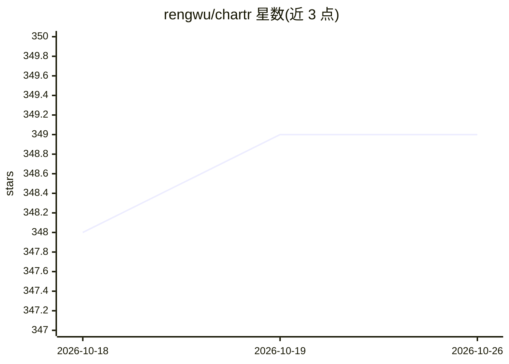

# rengwu/chartr

⭐ 349 · Rust · GPL-3.0 · 推送 2026-10-21 · [GitHub](https://github.com/rengwu/chartr) · [官网](https://chartr.dev) · 个人维护

**终端优先的 agentic 工作区：把项目、终端、CLI agent 与插件组织在一处**

基于 Rust 和 GPUI 构建的开源原生桌面应用，面向使用命令行 agent 的开发者：将项目组织为 spaces，并排排列终端与插件工具，注册自己已有的 CLI agent 并以自定义参数、环境变量与提示词启动。内置 Herdr 维持终端会话在退出后存活，捆绑插件可浏览页面、复用提示词、管理技能，支持用 HTML/CSS/JavaScript 编写插件；配套 Wayfinder 用于查看工作地图、审阅工单并启动 agent。本地运行，无需账号。v0.3.2 为 macOS/Linux 的 Rust 版本，v0.2.4 为旧版 Go/Svelte 应用。

## 筛选速览

| 维度 | 判定 | 备注 |
|---|---|---|
| AI 角色 | `ai-ecosystem` | LLM/agent 周边工具 |
| 许可风险 | `viral` | GPL-3.0 |
| 部署形态 | `None` |  |
| 模型依赖 | — | README 未给出锁定关系 |
| 硬件要求 | — | 无带数字的原话,不猜 |
| 安装摩擦 | `low` | 无编译、无系统依赖或容器化 |
| 成熟度 | — | 结构信号不足 |

## 能力要点

- 以 folders-as-spaces 组织项目终端与工具，支持 Tabs/Spaces 视图与分屏
- 注册并启动用户已有的 CLI agent（自定义参数、环境、提示词）
- Herdr 持久化终端会话，退出后恢复会话与布局
- 插件系统支持用 HTML/CSS/JavaScript 编写，内置页面浏览、提示词复用、技能管理插件

## 适用场景

- 在一个桌面应用里集中管理多个项目的终端与 CLI agent
- 退出应用后保持终端会话运行并恢复工作区布局
- 在终端旁并排使用浏览、提示词、技能管理等插件工具

## 场景标签

`Agent 框架` · 领域:Agent 开发

## 证据(README 行号)

> L35: - **Bring your CLI agents** — Register the agents you already use and launch
> L36:  them with your own arguments, environment, and prompts.

## 星数曲线

2026-10-18 348 → 2026-10-26 349（+1）

---
*卡片 v1 · prompt 1.4 · 生成 2026-10-21 · 置信度 high · 依据 README sha `19cbac3a60b7` · [字段定义](../../DATASET.md)*
