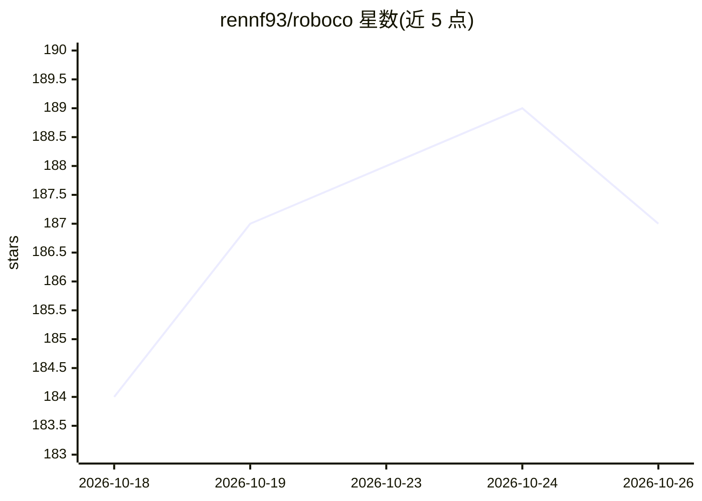

# rennf93/roboco

⭐ 187 · Python · AGPL-3.0 · 推送 2026-10-23 · [GitHub](https://github.com/rennf93/roboco) · [官网](http://roboco.tech/) · 个人维护

**面向独立开发者的 26 个 AI agent 虚拟软件公司**

由 1 名人类 CEO 与 26 个 AI agent（Intake、秘书、PR 审查、DevOps、董事会、3 个 6 人开发单元等）组成的虚拟软件公司：任务经需求评审→子任务拆解→开发→QA→文档→PR 合并的流水线处理，仅人类 CEO 可合并到 master。Agent 默认运行在 Anthropic Claude 上，可选 xAI Grok、OpenAI Codex、Google Gemini、Moonshot Kimi K3（各走官方 CLI 与订阅）或 Nebius Token Factory（计量 API key）。以 Docker Compose 全栈部署，含控制面板与 REST API；自述为 v0 早期原型，API/数据库结构不稳定。

## 筛选速览

| 维度 | 判定 | 备注 |
|---|---|---|
| AI 角色 | `ai-native` | 本体是模型或模型工具 |
| 许可风险 | `viral` | AGPL-3.0 |
| 部署形态 | `self-host` | docker 或自建部署 |
| 模型依赖 | locked-api |  |
| 硬件要求 | — | 无带数字的原话,不猜 |
| 安装摩擦 | `low` | 无编译、无系统依赖或容器化 |
| 成熟度 | `idea` | |

## 能力要点

- 26 个 agent 按组织层级分工，走 build→review→document→merge 流水线
- 多模型提供商可选：Claude/Grok/Codex/Gemini/Kimi K3/Nebius
- 每个 agent 独立 git clone 工作区，支持并行开发与 PR 审查门禁
- 36 个功能开关覆盖通信、治理、预算、Obsidian 知识库投影等

## 适用场景

- 独立开发者用一支 AI agent 团队并行推进多项目开发
- 以人类审批节点把控 AI 产出的需求、PR 与合并
- 在自建服务器上探索多 agent 组织化协作模式

## 场景标签

`多智能体` `编码 Agent` · 领域:Agent 开发

## 证据(README 行号)

> L3: AI Agents Company - A virtual organization of 26 AI agents + 1 human CEO, designed to operate as a complete software
> L32: The 26 agents = Intake + Secretary + PR Reviewer + DevOps + the Board (3) + Main PM + the three 6-agent cells (18).
> L36: You hand a task to the company; it runs through a real *build → review → document → merge* pipeline and comes back 

## 星数曲线

2026-10-18 184 → 2026-10-26 187（+3）

---
*卡片 v1 · prompt 1.4 · 生成 2026-10-22 · 置信度 high · 依据 README sha `4e861e586955` · [字段定义](../../DATASET.md)*
