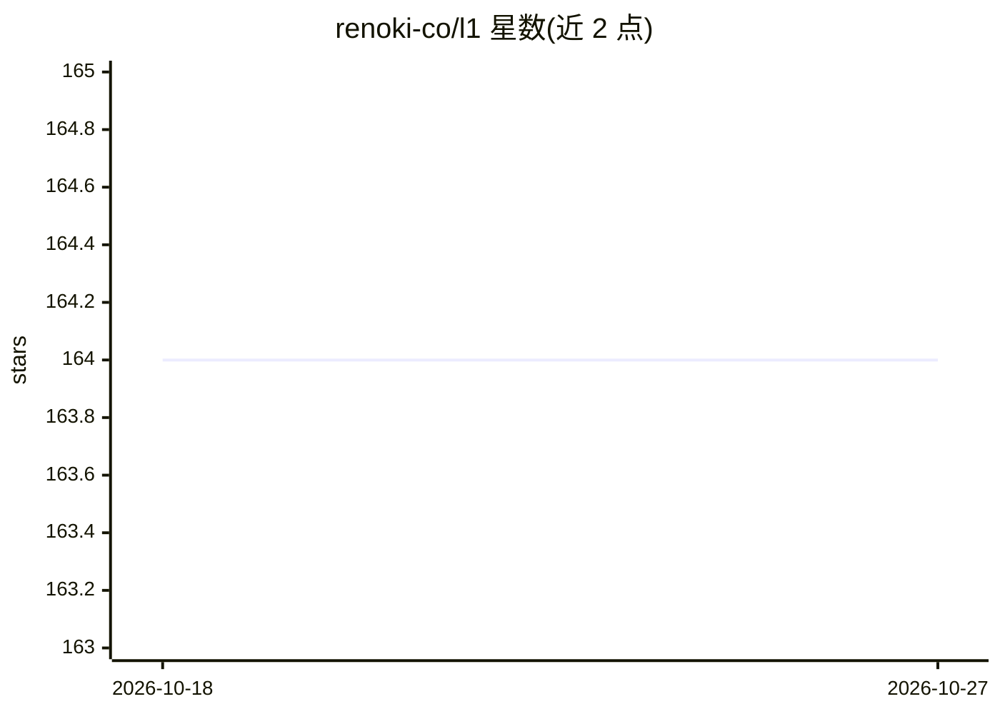

# renoki-co/l1

⭐ 164 · PHP · Apache-2.0 · 推送 2026-02-02 · [GitHub](https://github.com/renoki-co/l1) · 个人维护

**Laravel/PHP 接入 Cloudflare D1 数据库的连接器包**

通过 Composer 安装的 PHP 包，为 Laravel/PHP 应用提供 Cloudflare D1 数据库绑定：实现 D1Pdo 驱动，将 PDO 查询与绑定代理到 Cloudflare D1 的 /query API 端点（D1 本身不支持 SQL 协议直连）；在 config/database.php 中注册 d1 驱动并配置 Cloudflare Token、Account ID、Database ID 即可使用。KV 与 Queues 绑定列于路线图但未实现。测试依赖内置的模拟 Cloudflare API 的 Worker。

## 筛选速览

| 维度 | 判定 | 备注 |
|---|---|---|
| AI 角色 | `ai-enhanced` | 去掉 AI 部分产品仍成立 |
| 许可风险 | `permissive` | Apache-2.0 |
| 部署形态 | `None` |  |
| 模型依赖 | — | README 未给出锁定关系 |
| 硬件要求 | — | 无带数字的原话,不猜 |
| 安装摩擦 | `low` | 无编译、无系统依赖或容器化 |
| 成熟度 | `idea` | |

## 能力要点

- D1Pdo 驱动将 PDO 查询代理到 D1 /query API 端点
- Laravel 数据库配置中注册 d1 驱动使用
- KV 与 Queues 绑定在路线图中尚未实现

## 适用场景

- Laravel 应用把 Cloudflare D1 作为数据库连接使用
- PHP 项目通过 PDO 接口查询 D1 而无需 SQL 协议直连

## 场景标签

 · 领域:Web 开发/云服务集成

## 证据(README 行号)

> L11: Extend your PHP/Laravel application with Cloudflare bindings.
> L15: - [x] Cloudflare D1

## 星数曲线

2026-10-18 164 → 2026-10-27 164（+0）

---
*卡片 v1 · prompt 1.4 · 生成 2026-10-22 · 置信度 low · 依据 README sha `17269e40bbbe` · [字段定义](../../DATASET.md)*
