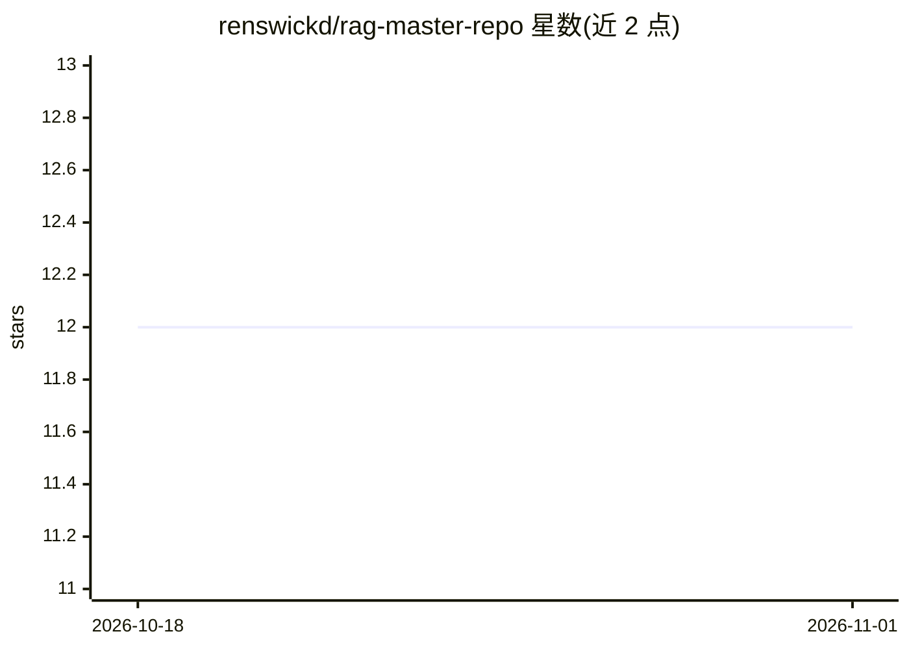

# renswickd/rag-master-repo

⭐ 12 · Python · 推送 2026-01-16 · [GitHub](https://github.com/renswickd/rag-master-repo) · 个人维护

**模块化 RAG 流水线仓库：七种 RAG 变体与持久向量库**

提供七种可切换 RAG 流水线的代码仓库：基础文本 RAG（GROQ）、多模态 RAG（CLIP + GPT-4.1）、LangGraph 双节点 RAG、基于角色的 UBAC 访问控制 RAG（元数据过滤）、Q&A 缓存 RAG、带工具调用的 Agentic-RAG（简历检索/网页搜索/汇率转换）及 HyDE RAG。PDF 经 PyMuPDF 摄取分块后存入 ChromaDB 持久集合，每类 RAG 独立 collection；统一 CLI 支持向量化、查询、列出与删除集合。需配置 GROQ/OpenAI 等 API key，bash setup.sh 一键建环境。

## 筛选速览

| 维度 | 判定 | 备注 |
|---|---|---|
| AI 角色 | `ai-ecosystem` | LLM/agent 周边工具 |
| 许可风险 | `none` | — |
| 部署形态 | `library` | 以包/库形式分发 |
| 模型依赖 | locked-api |  |
| 硬件要求 | — | 无带数字的原话,不猜 |
| 安装摩擦 | `low` | 无编译、无系统依赖或容器化 |
| 成熟度 | — | 结构信号不足 |

## 能力要点

- 七种 RAG 变体（基础/多模态/LangGraph/UBAC/缓存/Agentic/HyDE）可切换
- ChromaDB 持久化存储，每类 RAG 独立 collection
- CLI 覆盖向量化、查询、集合列出与删除
- Grounded prompts 强制仅基于检索上下文回答

## 适用场景

- 我要对比不同 RAG 架构在同一批 PDF 上的效果
- 我需要带角色权限控制的企业知识库问答
- 我想搭建带缓存或工具调用的 Agentic RAG 原型

## 场景标签

`RAG` `文档问答` · 领域:知识与检索

## 证据(README 行号)

> L3: A modular Retrieval-Augmented Generation (RAG) repository with swappable pipelines and persistent vector stores (Chr
> L17: - Modular retrievers, prompts, and pipelines
> L19: - CLI for vectorizing, querying, inspecting, listing, and deleting collections

## 星数曲线

2026-10-18 12 → 2026-11-01 12（+0）

---
*卡片 v1 · prompt 1.4 · 生成 2026-11-01 · 置信度 mid · 依据 README sha `7f53cfd3653c` · [字段定义](../../DATASET.md)*
