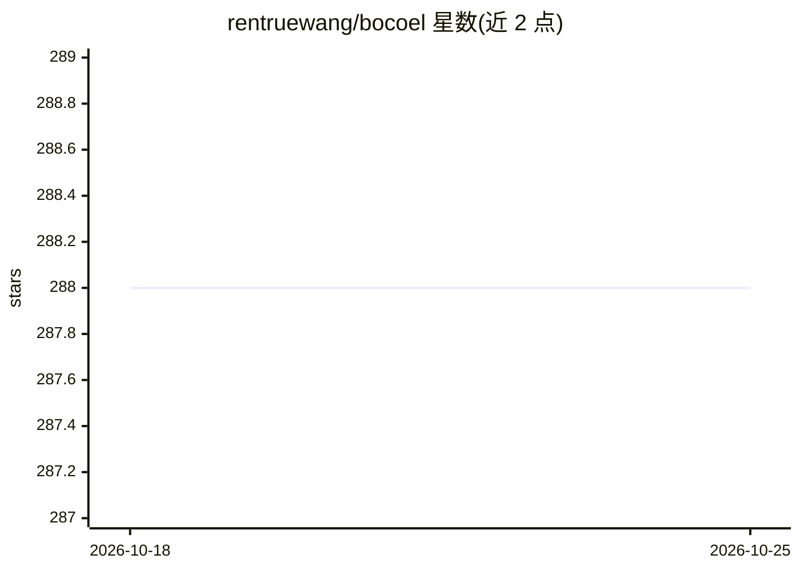

# rentruewang/bocoel

⭐ 288 · Python · BSD-3-Clause · 推送 2026-09-08 · [GitHub](https://github.com/rentruewang/bocoel) · [官网](https://bocoel.rentruewang.com/) · 个人维护

**用贝叶斯优化精选子集，低成本评测大语言模型**

Python 库，通过编码语料为嵌入向量，再用贝叶斯优化（高斯过程+采集函数）选取代表性样本子集，以少量样本对大语言模型做评测/基准测试，从而降低评测开销；提供管理评测结果的 manager 工具，支持 GPT2、Pythia、LLAMA 等（经 HuggingFace transformers/datasets 集成）。README 于 2025/09/14 声明归档，作者转向新项目。安装方式为 pip。

## 筛选速览

| 维度 | 判定 | 备注 |
|---|---|---|
| AI 角色 | `ai-ecosystem` | LLM/agent 周边工具 |
| 许可风险 | `permissive` | BSD-3-Clause |
| 部署形态 | `library` | 以包/库形式分发 |
| 模型依赖 | — | README 未给出锁定关系 |
| 硬件要求 | — | 无带数字的原话,不猜 |
| 安装摩擦 | `low` | 无编译、无系统依赖或容器化 |
| 成熟度 | — | 结构信号不足 |

## 能力要点

- 贝叶斯优化在嵌入空间中选取评测子集
- 数十样本即可在选定语料上评测大语言模型
- 支持 GPT2/Pythia/LLAMA（经 HuggingFace 集成）
- 提供评测结果 manager 管理工具

## 适用场景

- 在大规模数据集上低成本评测大语言模型
- 在有限评测预算下选取代表性样本子集
- 管理并复用已生成的评测结果

## 场景标签

`模型评测` · 领域:评测与运维

## 证据(README 行号)

> L11: ## Bayesian Optimization as a Coverage Tool for Evaluating Large Language Models
> L35: 2. Use Bayesian optimization to select queries to evaluate.
> L45: - 🎯 Accurately evaluate large language models with just tens of samples from your selected corpus.

## 星数曲线

2026-10-18 288 → 2026-10-25 288（+0）

---
*卡片 v1 · prompt 1.4 · 生成 2026-10-22 · 置信度 high · 依据 README sha `8a9fa24213fd` · [字段定义](../../DATASET.md)*
