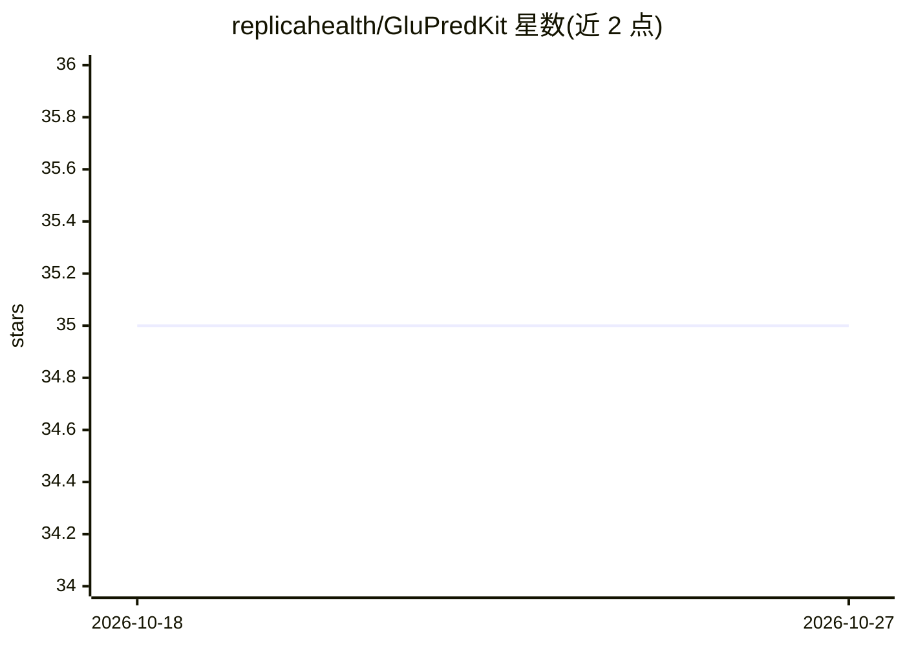

# replicahealth/GluPredKit

⭐ 35 · Python · MIT · 推送 2026-10-06 · [GitHub](https://github.com/replicahealth/GluPredKit) · 组织维护

**血糖预测模型训练与评估框架（CLI，Python）**

面向 1 型糖尿病研究的血糖（BG）预测框架：以 Python 包和命令行界面提供端到端流程——从 Tidepool/Nightscout/Apple Health/Ohio T1DM/OpenAPS/T1DEXI 等数据源解析 CGM 数据，生成训练配置（预测时程、滞后特征、预处理器选择），训练模型（LSTM、双 LSTM、Tidepool Loop 生理模型等）并评估。数据、模型与结果存储在本地文件夹，提供合成数据集供测试。限制：解析器作者标注仍在完善中；mpi4py 依赖需要系统级 MPI 库；TensorFlow 路径推荐 Python 3.9。

## 筛选速览

| 维度 | 判定 | 备注 |
|---|---|---|
| AI 角色 | `ai-native` | 本体是模型或模型工具 |
| 许可风险 | `permissive` | MIT |
| 部署形态 | `library` | 以包/库形式分发 |
| 模型依赖 | — | README 未给出锁定关系 |
| 硬件要求 | — | 无带数字的原话,不猜 |
| 安装摩擦 | `low` | 无编译、无系统依赖或容器化 |
| 成熟度 | `idea` | |

## 能力要点

- 7 种数据源解析器（Tidepool/Nightscout/Apple Health/Ohio T1DM/OpenAPS/T1DEXI 等）
- 配置化训练：预测时程、时间滞后特征、what-if 特征与两种预处理器可选
- 内置 LSTM、双 LSTM、Tidepool Loop 生理模型等模型
- 提供合成数据集与 setup_directories 一键目录初始化

## 适用场景

- 用自己或公开 CGM 数据集训练血糖预测模型
- 在统一框架下对比不同预测时程与模型的效果
- 快速上手：用内置合成数据跑通完整训练评估流程

## 场景标签

`模型训练` `模型评测` · 领域:评测与运维

## 证据(README 行号)

> L8: This Blood Glucose (BG) Prediction Framework streamlines the process of data handling, training, and evaluating bloo
> L77: The command-line tool is designed to streamline the end-to-end process of data handling, preprocessing, model train
> L213: glupredkit train_model CONFIG_FILE_NAME [OPTIONS]

## 星数曲线

2026-10-18 35 → 2026-10-27 35（+0）

---
*卡片 v1 · prompt 1.4 · 生成 2026-10-25 · 置信度 high · 依据 README sha `2c79322db58e` · [字段定义](../../DATASET.md)*
