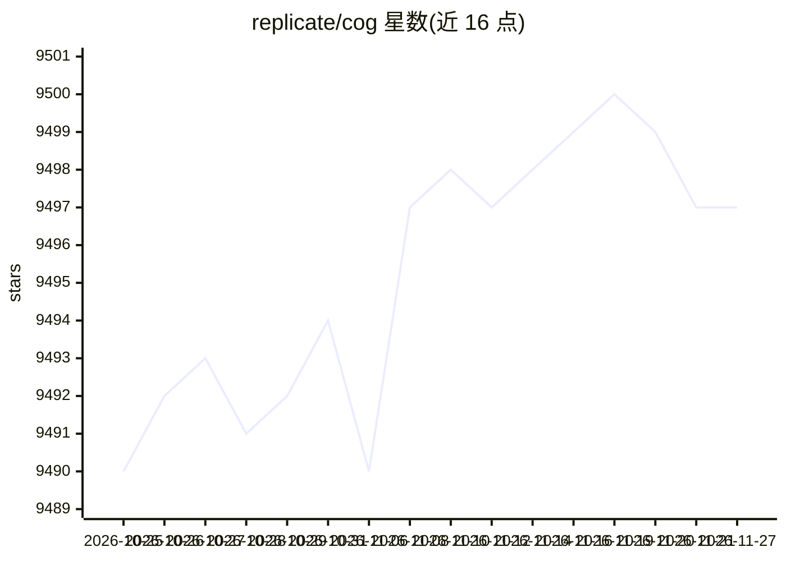

# replicate/cog

⭐ 9,497 · Go · Apache-2.0 · 推送 2026-11-24 · [GitHub](https://github.com/replicate/cog) · [官网](https://cog.run) · 组织维护

**帮开发者把机器学习模型打包为生产级容器并部署的工具**

Replicate 维护的开源 CLI 工具：用户以 cog.yaml 声明模型运行环境、以 Python 定义输入输出，工具据此生成遵循实践的 Docker 镜像，自动处理 CUDA/cuDNN/PyTorch/TensorFlow/Python 版本组合，并用 Rust/Axum 动态生成 RESTful HTTP 推理 API 与 OpenAPI schema。产物可部署到自有基础设施或 Replicate。需先安装 Docker；macOS/Linux 支持，Windows 11 需经 WSL 2 运行。

## 筛选速览

| 维度 | 判定 | 备注 |
|---|---|---|
| AI 角色 | `ai-ecosystem` | LLM/agent 周边工具 |
| 许可风险 | `permissive` | Apache-2.0 |
| 部署形态 | `self-host` | docker 或自建部署 |
| 模型依赖 | — | README 未给出锁定关系 |
| 硬件要求 | — | 无带数字的原话,不猜 |
| 安装摩擦 | `low` | 无编译、无系统依赖或容器化 |
| 成熟度 | — | 结构信号不足 |

## 能力要点

- 以配置文件自动生成含最佳实践的 Docker 镜像
- 自动配置兼容的 CUDA/cuDNN/PyTorch/TensorFlow/Python 组合
- 依据模型类型自动生成 HTTP 推理服务与 OpenAPI schema
- 提供 run/build/serve 子命令覆盖本地运行与部署

## 适用场景

- 把研究阶段的模型打包成可部署的容器镜像
- 在自有服务器或 GPU 机器上托管模型推理 API
- 避免手写 Dockerfile 与 CUDA 版本调试

## 场景标签

`推理引擎` `MLOps` · 领域:训练与推理

## 证据(README 行号)

> L3: Cog is an open-source tool that lets you package machine learning models in a standard, production-ready container.
> L15: - 🎁 **Automatic HTTP inference server**: Your model's types are used to dynamically generate a RESTful HTTP API usi
> L17: - 🚀 **Ready for production.** Deploy your model anywhere that Docker images run. Your own infrastructure, or Replic

## 星数曲线

2026-10-25 9,490 → 2026-11-27 9,497（+7）

---
*卡片 v1 · prompt 1.4 · 生成 2026-11-22 · 置信度 mid · 依据 README sha `c65a2f05740a` · [字段定义](../../DATASET.md)*
