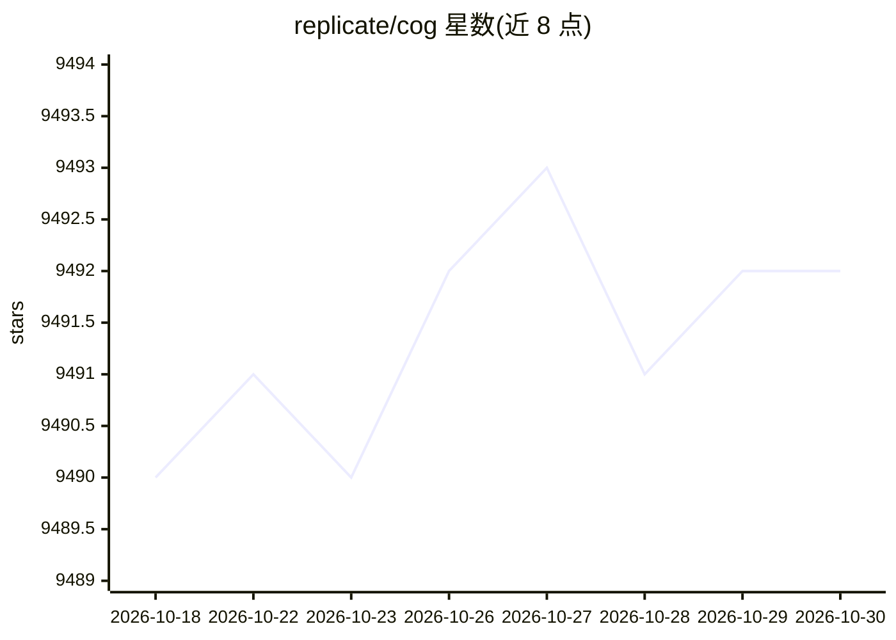

# replicate/cog

⭐ 9,492 · Go · Apache-2.0 · 推送 2026-10-29 · [GitHub](https://github.com/replicate/cog) · [官网](https://cog.run) · 组织维护

**将机器学习模型打包为生产级 Docker 容器的工具**

Cog 由 Replicate 维护，面向需要把模型部署到生产环境的研究者与工程师：用 cog.yaml 定义环境（GPU、系统包、Python 版本），Cog 生成符合实践的 Docker 镜像，自动处理 CUDA/cuDNN/PyTorch/TensorFlow 版本兼容；用标准 Python 定义模型输入输出并生成 OpenAPI schema 与 RESTful HTTP 推理服务（Rust/Axum 实现）。镜像可部署到自有基础设施或 Replicate。安装提供 brew、install 脚本、手动下载二进制等方式，需先安装 Docker；支持 macOS/Linux，Windows 11 仅经 WSL 2 运行。

## 筛选速览

| 维度 | 判定 | 备注 |
|---|---|---|
| AI 角色 | `ai-ecosystem` | LLM/agent 周边工具 |
| 许可风险 | `permissive` | Apache-2.0 |
| 部署形态 | `self-host` | docker 或自建部署 |
| 模型依赖 | — | README 未给出锁定关系 |
| 硬件要求 | — | 无带数字的原话,不猜 |
| 安装摩擦 | `low` | 无编译、无系统依赖或容器化 |
| 成熟度 | — | 结构信号不足 |

## 能力要点

- cog.yaml 定义环境，生成含 Nvidia 基础镜像与依赖缓存的 Docker 镜像
- 自动处理 CUDA/cuDNN/PyTorch/TensorFlow/Python 版本兼容
- 标准 Python 定义输入输出，自动生成 OpenAPI schema 与 HTTP 推理服务
- 支持 cog run/build/serve 命令，镜像可部署到任意 Docker 环境

## 适用场景

- 把研究模型打包成可部署的生产容器
- 为模型自动生成 HTTP 推理 API
- 部署模型到自有基础设施或 Replicate

## 场景标签

`推理引擎` · 领域:训练与推理

## 证据(README 行号)

> L3: Cog is an open-source tool that lets you package machine learning models in a standard, production-ready container.
> L17: - 🚀 **Ready for production.** Deploy your model anywhere that Docker images run. Your own infrastructure, or Replic
> L71: It's really hard for researchers to ship machine learning models to production.

## 星数曲线

2026-10-18 9,490 → 2026-10-30 9,492（+2）

---
*卡片 v1 · prompt 1.4 · 生成 2026-10-20 · 置信度 mid · 依据 README sha `92ca1544d386` · [字段定义](../../DATASET.md)*
