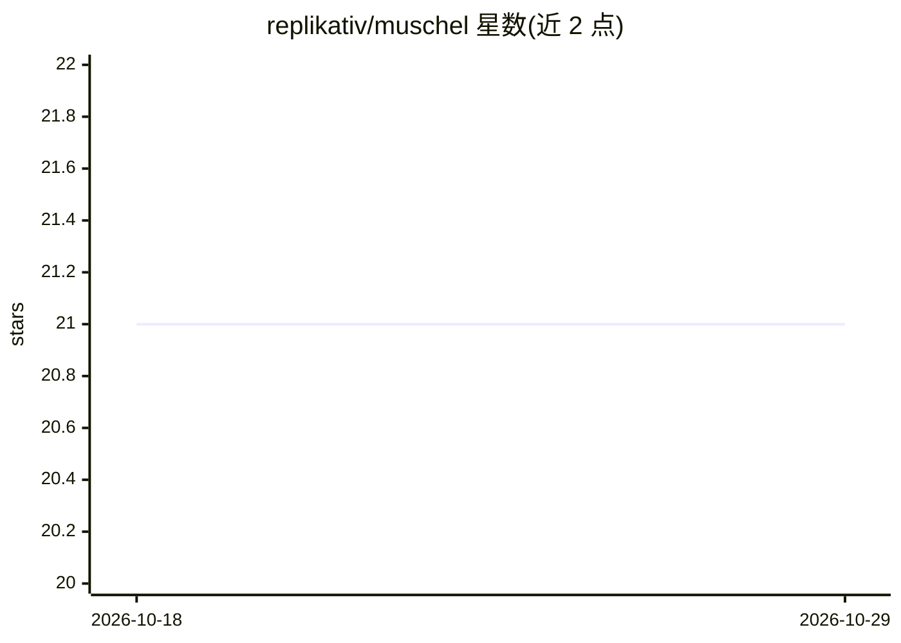

# replikativ/muschel

⭐ 21 · Clojure · Apache-2.0 · 推送 2026-07-28 · [GitHub](https://github.com/replikativ/muschel) · [官网](https://simm.is) · 组织维护

**为 LLM agent 沙箱化执行 bash 的 Clojure(Script) 解释器库**

Clojure(Script) 库，将 bash/POSIX shell 源码解析为结构化 AST，按 allow/deny permit 策略做解析期与运行期双重检查，再经可插拔 host（JVM、babashka、Node.js、浏览器虚拟文件系统）执行。面向需要让 agent 输出 shell 命令又不放开系统权限的场景：FS 协议做容器化路径限制，BuiltinHost 仅放行注册命令，可选 bubblewrap 外层沙箱与资源预算/追踪，并支持多轮 session 与 bash→Clojure 转译。限制：部分运行时跳过 DiskFS，SandboxedHost 仅 JVM/Linux。

## 筛选速览

| 维度 | 判定 | 备注 |
|---|---|---|
| AI 角色 | `ai-ecosystem` | LLM/agent 周边工具 |
| 许可风险 | `permissive` | Apache-2.0 |
| 部署形态 | `library` | 以包/库形式分发 |
| 模型依赖 | — | README 未给出锁定关系 |
| 硬件要求 | — | 无带数字的原话,不猜 |
| 安装摩擦 | `low` | 无编译、无系统依赖或容器化 |
| 成熟度 | — | 结构信号不足 |

## 能力要点

- bash 解析为 AST 并经 permit 解析期+运行期双重门控
- 四种运行时：JVM / babashka / Node.js / 浏览器（虚拟 FS、无 spawn）
- FS 协议 + BuiltinHost + 可选 bubblewrap 沙箱与资源预算、追踪
- 支持多轮 session 与 bash 到 Clojure 的转译（muschel.emit/translate）

## 适用场景

- 让 LLM agent 生成的 bash 在受控沙箱中执行而不暴露真实系统
- 在浏览器内用虚拟文件系统运行 shell 命令做教学或演示
- 对 agent shell 调用做细粒度 allow/deny 策略与审计追踪

## 场景标签

`Agent 框架` · 领域:Agent 开发

## 证据(README 行号)

> L7: **muschel** — German for *shell* (the bivalve). A Clojure(Script) library
> L13: Built for LLM agent shells: agents emit bash naturally, and muschel lets

## 星数曲线

2026-10-18 21 → 2026-10-29 21（+0）

---
*卡片 v1 · prompt 1.4 · 生成 2026-10-28 · 置信度 high · 依据 README sha `27cc3241459c` · [字段定义](../../DATASET.md)*
