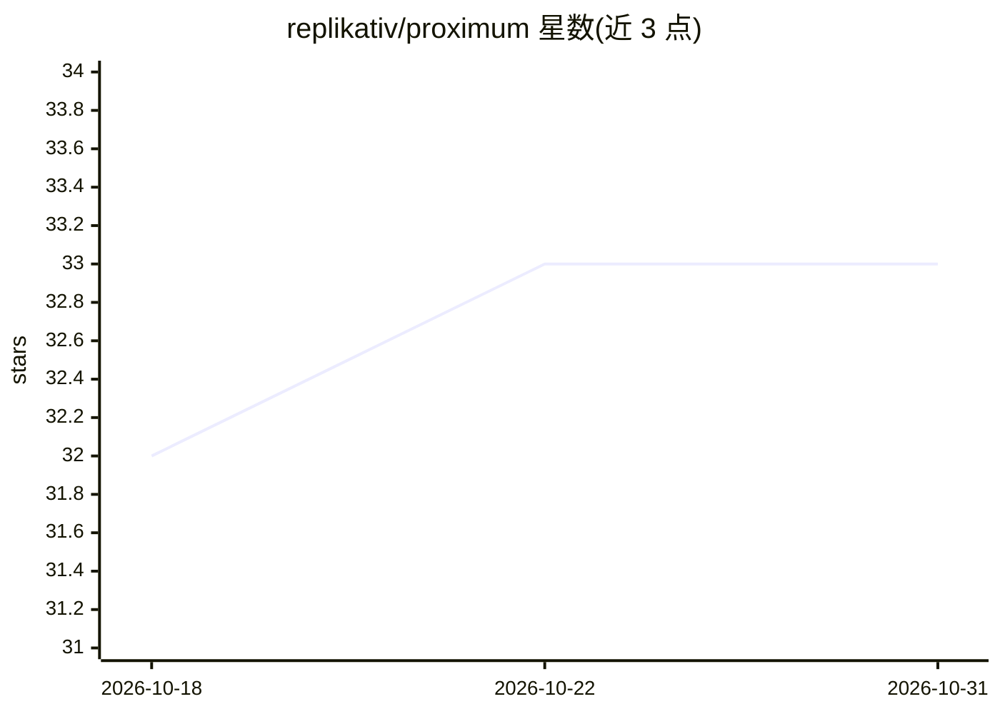

# replikativ/proximum

⭐ 33 · Clojure · Apache-2.0 · 推送 2026-08-31 · [GitHub](https://github.com/replikativ/proximum) · [官网](https://datahike.io/proximum) · 组织维护

**面向 Clojure/Java 的可嵌入向量库，带 Git 式版本与分支**

纯 JVM 的可嵌入向量数据库，提供 HNSW 近邻搜索、SIMD 加速、多租户过滤与元数据。区别于常规向量库之处在于持久化数据结构语义：每次 sync 生成 commit，可查询历史快照（time travel）、以 chunk 级 copy-on-write 实现低成本分支，并用 SHA-512 哈希提供防篡改审计链。存储后端可插拔（内存/文件/S3）。提供 Spring AI 与 LangChain4j 集成。README 声明处于 Early Beta，API 在 1.0 前可能变动；量化压缩（PQ/BQ/NVQ）仍在路线图中。要求 Java 22+。

## 筛选速览

| 维度 | 判定 | 备注 |
|---|---|---|
| AI 角色 | `ai-ecosystem` | LLM/agent 周边工具 |
| 许可风险 | `permissive` | Apache-2.0 |
| 部署形态 | `None` |  |
| 模型依赖 | — | README 未给出锁定关系 |
| 硬件要求 | — | 无带数字的原话,不猜 |
| 安装摩擦 | `medium` | 含编译或系统依赖之一 |
| 成熟度 | `idea` | |

## 能力要点

- Git 式版本化：每次 sync 生成 commit，支持 asOf 历史快照查询
- chunk 级 copy-on-write 分支，mmap 向量存储支持文件系统 reflink
- SHA-512 加密哈希提交链，提供防篡改审计
- 纯 JVM、无原生依赖，Java Vector API SIMD 加速

## 适用场景

- RAG/语义搜索中需要追踪与复现历史索引版本
- 对嵌入模型做 A/B 测试时并行分支实验
- 需要审计线索与合规留存的向量检索场景
- 在 Clojure 应用中嵌入持久化向量存储

## 场景标签

`向量数据库` · 领域:知识与检索

## 证据(README 行号)

> L11: A high-performance, embeddable vector database for Clojure and Java with **Git-like versioning** and **copy-on-writ
> L24: Perfect for **RAG applications**, **semantic search**, and **ML experimentation** where you need to track versions,
> L267:     .dimensions(1536)

## 星数曲线

2026-10-18 32 → 2026-10-31 33（+1）

---
*卡片 v1 · prompt 1.4 · 生成 2026-10-25 · 置信度 high · 依据 README sha `315ed355f84a` · [字段定义](../../DATASET.md)*
