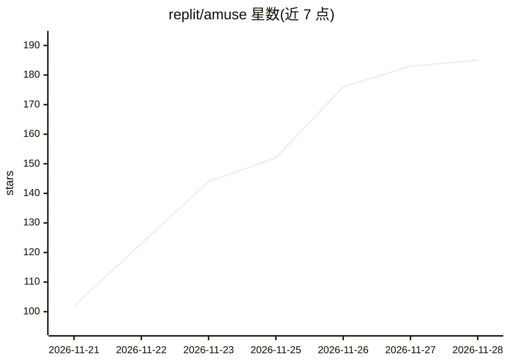

# replit/amuse

⭐ 185 · TypeScript · Apache-2.0 · 推送 2026-11-24 · [GitHub](https://github.com/replit/amuse) · 组织维护

**自托管个人 AI 助理：联网研究、实时浏览器、提醒与小应用**

在个人电脑上运行的单用户 AI 助理应用：以 OpenAI 模型为核心，提供带来源的网络搜索、可在聊天中观看和接管的实时浏览器、提醒与后台监控、目标计划追踪、可持久使用的小应用（文档/图像/播客等）、可编辑的记忆文件，以及语音模式。发送、提交表单、付款等敏感操作前需通过审批卡确认；登录凭据存于加密保险库，模型只见替身 token。部署方式为 Docker Compose 或源码运行，需 OpenAI API key 与 PostgreSQL；仅监听 127.0.0.1，无登录机制，不可暴露到网络。

## 筛选速览

| 维度 | 判定 | 备注 |
|---|---|---|
| AI 角色 | `ai-native` | 本体是模型或模型工具 |
| 许可风险 | `permissive` | Apache-2.0 |
| 部署形态 | `self-host` | docker 或自建部署 |
| 模型依赖 | — | README 未给出锁定关系 |
| 硬件要求 | — | 无带数字的原话,不猜 |
| 安装摩擦 | `low` | 无编译、无系统依赖或容器化 |
| 成熟度 | — | 结构信号不足 |

## 能力要点

- 实时浏览器自动化：可观看、接管或停止
- 审批卡机制：发送/提交/付款前确认，支持 once/task/site/always 范围
- 加密凭据保险库，模型只接收替身 token
- 日用量限额 AMUSE_DAILY_LIMIT，超限暂停后台任务

## 适用场景

- 个人网页研究并给出带来源的结果
- 让 agent 代为填表和浏览网站并随时接管
- 设置提醒与后台监控，重要事项才通知
- 通过对话生成可留存数据的小应用

## 场景标签

`AI 助手` `浏览器自动化` · 领域:效率与自动化

## 证据(README 行号)

> L3: Self-hosted personal AI agent: it researches the web, uses a live browser you can watch and take
> L5: asks before it sends, submits or pays for anything. Amuse runs on your own computer for one person.
> L58: The agent (`gpt-6.2-sol`, with `gpt-6-luna` for quick steps), web search, image generation

## 星数曲线

2026-11-21 102 → 2026-11-28 185（+83）

---
*卡片 v1 · prompt 1.4 · 生成 2026-11-26 · 置信度 mid · 依据 README sha `ebdd83385cc9` · [字段定义](../../DATASET.md)*
