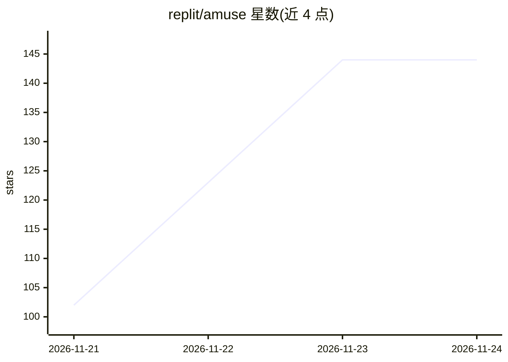

# replit/amuse

⭐ 144 · TypeScript · Apache-2.0 · 推送 2026-11-19 · [GitHub](https://github.com/replit/amuse) · 组织维护

**自托管个人 AI agent：网页研究、实时浏览器、提醒与小应用**

面向单人的自托管 Web 应用 agent：可进行带来源的网页研究、驱动一个可观看/可接管的实时浏览器填写表单、运行提醒与后台监控、把目标转为持续执行的分步计划，并按需生成带持久数据的小应用。发送、提交、付款等敏感动作前通过审批卡片请求确认；凭据存于加密保险库，模型只见到替身令牌。依赖 OpenAI API key 与 PostgreSQL，仅监听 127.0.0.1，无登录机制，不面向暴露到公网的部署。

## 筛选速览

| 维度 | 判定 | 备注 |
|---|---|---|
| AI 角色 | `ai-native` | 本体是模型或模型工具 |
| 许可风险 | `permissive` | Apache-2.0 |
| 部署形态 | `self-host` | docker 或自建部署 |
| 模型依赖 | — | README 未给出锁定关系 |
| 硬件要求 | — | 无带数字的原话,不猜 |
| 安装摩擦 | `low` | 无编译、无系统依赖或容器化 |
| 成熟度 | — | 结构信号不足 |

## 能力要点

- 实时浏览器可观看、接管或停止，用于填表与站点导航
- 审批卡片控制发送/提交/付款/新定时任务，支持多种授权范围
- 加密保险库保存登录凭据，模型只看到替身令牌
- 内存以纯文本工作区文件存储，可读可编辑

## 适用场景

- 在本机托管一个可委托网页研究与填表的个人助手
- 让 agent 持续跟进目标计划并在关键动作前征求确认
- 用对话生成并保留日常使用的小型应用

## 场景标签

`AI 助手` `浏览器自动化` · 领域:效率与自动化

## 证据(README 行号)

> L3: Self-hosted personal AI agent: it researches the web, uses a live browser you can watch and take
> L5: asks before it sends, submits or pays for anything. Amuse runs on your own computer for one person.
> L56: The agent (`gpt-6.2-sol`, with `gpt-6-luna` for quick steps), web search, image generation

## 星数曲线

2026-11-21 102 → 2026-11-24 144（+42）

---
*卡片 v1 · prompt 1.4 · 生成 2026-11-21 · 置信度 mid · 依据 README sha `47ea7bc5ef53` · [字段定义](../../DATASET.md)*
