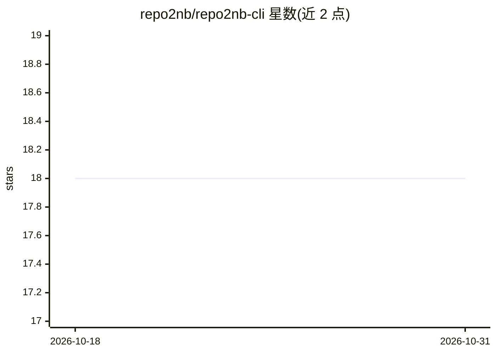

# repo2nb/repo2nb-cli

⭐ 18 · Python · MIT · 推送 2026-08-23 · [GitHub](https://github.com/repo2nb/repo2nb-cli) · 个人维护

**把本地代码仓库转成 Kaggle/Colab 可运行笔记本的 CLI 工具**

Python 命令行工具：将本地训练代码仓库转换为自包含 Jupyter notebook（.ipynb），把文件树翻译为按序排列的 %%writefile 单元格，自动检测依赖并生成 pip install 单元，注入带 Git 认证的 pull/push 单元格；默认面向 Kaggle 免费 GPU 环境，也支持 Google Colab。自动跳过缓存、虚拟环境、锁文件与数据文件，并提供 reverse（从 notebook 反向重建仓库）与 sync（增量更新）子命令。作者声明面向个人与学术项目，服务学生和爱好者利用免费 GPU 算力，不适用于管理大规模企业仓库。

## 筛选速览

| 维度 | 判定 | 备注 |
|---|---|---|
| AI 角色 | `ai-ecosystem` | LLM/agent 周边工具 |
| 许可风险 | `permissive` | MIT |
| 部署形态 | `library` | 以包/库形式分发 |
| 模型依赖 | — | README 未给出锁定关系 |
| 硬件要求 | — | 无带数字的原话,不猜 |
| 安装摩擦 | `low` | 无编译、无系统依赖或容器化 |
| 成熟度 | — | 结构信号不足 |

## 能力要点

- 文件树自动翻译为按序 %%writefile 单元格
- 依赖自动检测（poetry/uv/requirements.txt/imports）
- 注入带 token 的 Git 初始化与 pull/push 单元格
- reverse 反向重建与 sync 增量更新子命令

## 适用场景

- 学生/爱好者把本地训练仓库一键搬上 Kaggle/Colab 免费 GPU 运行
- 在云端笔记本中通过 Git 拉取与回推代码改动
- 本地修改后增量同步已有 notebook 而非重新生成

## 场景标签

 · 领域:机器学习工具链/开发工具

## 证据(README 行号)

> L10: repo2nb CLI is an open-source Python CLI tool that converts a local code repository into a self-contained Jupyter n
> L35: python -m repo2nb ./my_project --output my_project_kaggle.ipynb
> L50: - **Multi-Target**: Generate for Kaggle (default) or Google Colab (`--target colab`).

## 星数曲线

2026-10-18 18 → 2026-10-31 18（+0）

---
*卡片 v1 · prompt 1.4 · 生成 2026-10-29 · 置信度 high · 依据 README sha `b6f167f90d78` · [字段定义](../../DATASET.md)*
