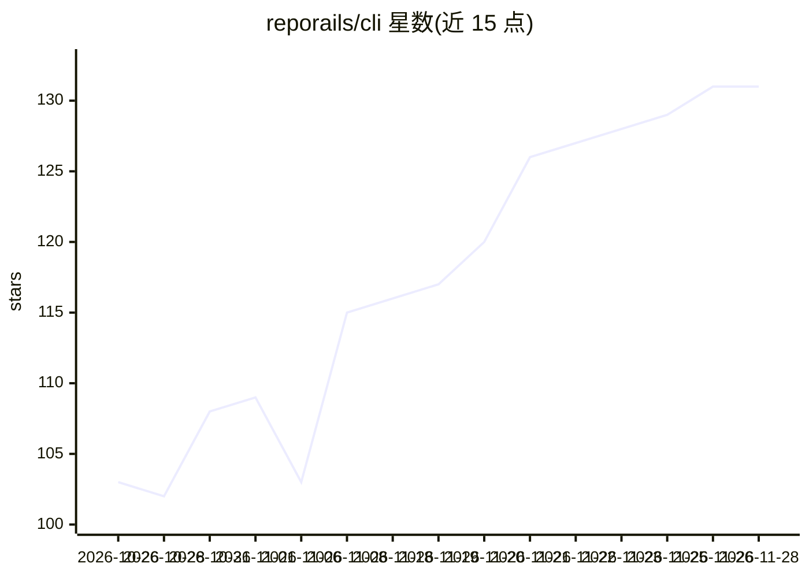

# reporails/cli

⭐ 131 · Python · NOASSERTION · 推送 2026-11-25 · [GitHub](https://github.com/reporails/cli) · [官网](https://reporails.com/) · 组织维护

**为 AI 编码代理的指令文件做诊断与修复的 CLI 工具**

针对 Claude、Codex、Copilot、Cursor、Antigravity 等编码代理，用 120+ 条规则（核心包+各代理专属包）检查 agentic 指令系统，输出 Quality 分数与问题清单。提供 xray 本地页面展示 Claude Code 会话上下文窗口的占用来源；可安装为各代理插件，Pro 账户支持自动改写指令文件；提供 GitHub Action 在 PR 中做回归检查，分析模型（约 275 MB）可缓存于 Actions cache。许可为 BUSL 1.1，每版发布三年后转 Apache 2.0。

## 筛选速览

| 维度 | 判定 | 备注 |
|---|---|---|
| AI 角色 | `ai-ecosystem` | LLM/agent 周边工具 |
| 许可风险 | `none` | NOASSERTION |
| 部署形态 | `library` | 以包/库形式分发 |
| 模型依赖 | — | README 未给出锁定关系 |
| 硬件要求 | — | 无带数字的原话,不猜 |
| 安装摩擦 | `low` | 无编译、无系统依赖或容器化 |
| 成熟度 | `idea` | |

## 能力要点

- 120+ 规则、六类规则包检查 AI 指令文件质量
- xray 从 ~/.claude/projects 转录生成上下文占用视图
- GitHub Action 集成，支持 strict/min-score 阈值退出
- Claude Code 与 Codex 可自动安装插件，Pro 支持自动修复

## 适用场景

- 在 CI 中像 lint 一样拦截指令质量回退
- 排查 Claude Code 会话上下文窗口被什么占满
- 检查并修写跨文件重复、含糊或过大的 agent 指令

## 场景标签

 · 领域:开发者工具/AI 编码辅助

## 证据(README 行号)

> L3: > **AI Instruction Diagnostics for coding agents. Validates the entire agentic instruction system against 120+ rules
> L46: Puts `ails` on your PATH, installs the reporails plugin into Claude Code and Codex when they are on your machine, a

## 星数曲线

2026-10-26 103 → 2026-11-28 131（+28）

---
*卡片 v1 · prompt 1.4 · 生成 2026-11-28 · 置信度 high · 依据 README sha `3c7dc31cecfb` · [字段定义](../../DATASET.md)*
