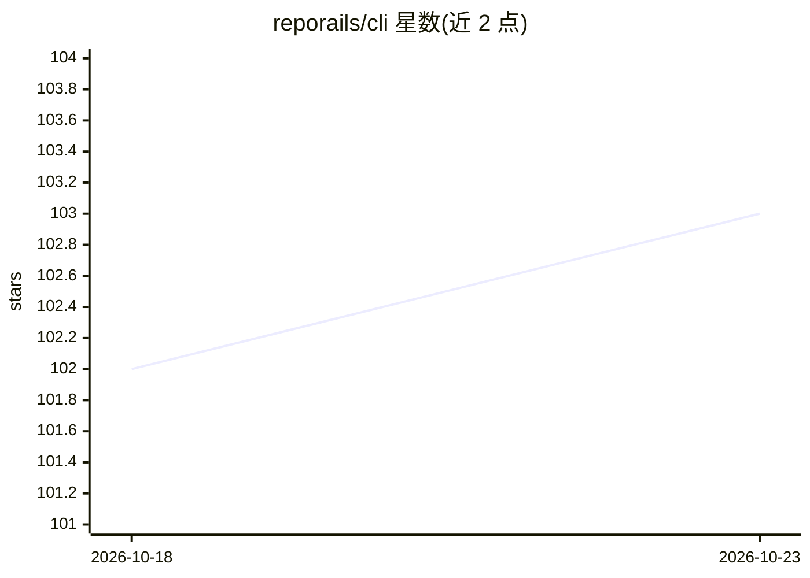

# reporails/cli

⭐ 103 · Python · NOASSERTION · 推送 2026-10-22 · [GitHub](https://github.com/reporails/cli) · [官网](https://reporails.com/) · 组织维护

**给开发者的 AI 编码代理指令质量诊断 CLI**

面向使用 Claude、Codex、Copilot、Cursor、Antigravity 等编码代理的开发者的命令行诊断工具：以 120+ 规则、六套规则包（核心 + 每代理）校验整个代理指令系统，输出单一 Quality 分数与发现清单；提供 CI Action 集成（PR 门禁、可设最低分与 strict 退出），并在安装时向 Claude Code 与 Codex 注入 reporails 插件。本地模型约 275 MB，首跑下载。免费与匿名账户共享完整诊断，Pro 付费订阅解锁修复写入（heal）、提升配额与逐行重复定位。许可为 BUSL 1.1，各版本发布三年后转为 Apache 2.0。

## 筛选速览

| 维度 | 判定 | 备注 |
|---|---|---|
| AI 角色 | `ai-ecosystem` | LLM/agent 周边工具 |
| 许可风险 | `none` | NOASSERTION |
| 部署形态 | `library` | 以包/库形式分发 |
| 模型依赖 | — | README 未给出锁定关系 |
| 硬件要求 | — | 无带数字的原话,不猜 |
| 安装摩擦 | `low` | 无编译、无系统依赖或容器化 |
| 成熟度 | `idea` | |

## 能力要点

- 120+ 规则、六套规则包（核心 + 每代理）校验代理指令系统
- npx/uvx 免安装运行，也可永久安装并注入 Claude Code/Codex 插件
- GitHub Action 在 PR 上拦截指令质量回归，可设 min-score 与 strict
- CI 中通过 Actions 缓存约 275 MB 分析模型

## 适用场景

- 在 PR 流水线中像测试/lint 一样拦截指令质量回归
- 对团队的 AGENTS.md/CLAUDE.md 等指令文件做评分与体检
- 统一管理多个编码代理（Claude/Codex/Copilot/Cursor）的指令规范

## 场景标签

 · 领域:开发者工具/AI 代理配置质量

## 证据(README 行号)

> L3: > **AI Instruction Diagnostics for coding agents. Validates the entire agentic instruction system against 120+ rules
> L32: Puts `ails` on your PATH, installs the reporails plugin into Claude Code and Codex when they are on your machine, a
> L47: Run on every PR so instruction-quality regressions (vague or buried instructions, oversized files, weak reinforceme

## 星数曲线

2026-10-18 102 → 2026-10-23 103（+1）

---
*卡片 v1 · prompt 1.4 · 生成 2026-10-23 · 置信度 high · 依据 README sha `eb09948d60a9` · [字段定义](../../DATASET.md)*
