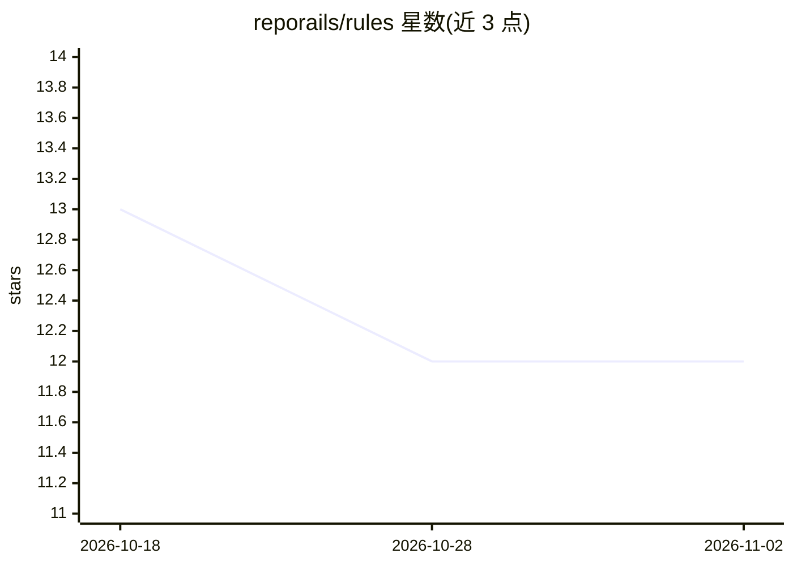

# reporails/rules

⭐ 12 · Shell · NOASSERTION · 推送 2026-02-24 · [GitHub](https://github.com/reporails/rules) · 组织维护

**校验 AI 编程代理指令文件的规则库（90 条规则）**

针对 CLAUDE.md、.cursorrules、copilot-instructions.md 等 AI 代理指令文件提供校验规则：core 目录按 structure（25 条）、content（32 条）等类别组织，共 90 条规则，另有 L1-L6 能力分级模型与规则 Schema 文档。通过 npx @reporails/cli install 注册 MCP server 到 Claude Code，或用 npx @reporails/cli check 直接运行校验。社区维护，版本 0.5.0，自述 pre-1.0、API 仍在演进。

## 筛选速览

| 维度 | 判定 | 备注 |
|---|---|---|
| AI 角色 | `ai-ecosystem` | LLM/agent 周边工具 |
| 许可风险 | `none` | NOASSERTION |
| 部署形态 | `library` | 以包/库形式分发 |
| 模型依赖 | — | README 未给出锁定关系 |
| 硬件要求 | — | 无带数字的原话,不猜 |
| 安装摩擦 | `low` | 无编译、无系统依赖或容器化 |
| 成熟度 | `idea` | |

## 能力要点

- 90 条规则覆盖结构、内容、效率、治理、维护等维度
- MCP server 方式接入 Claude Code 运行校验
- 也可不经 MCP 直接用 CLI 运行 check
- 提供 L1-L6 能力分级模型与规则 Schema 文档

## 适用场景

- 校验 CLAUDE.md / .cursorrules 等代理指令文件的质量
- 团队为 AI 编程代理指令建立治理规范
- 了解指令文件应具备的结构与内容要求

## 场景标签

`提示工程` · 领域:Agent 开发

## 证据(README 行号)

> L3: Validation rules for AI agent instruction files (CLAUDE.md, .cursorrules, copilot-instructions.md).
> L29:   structure/       # 25 rules: File presence, nesting, format, hooks, skills
> L30:   content/         # 32 rules: Context, commands, conventions, constraints

## 星数曲线

2026-10-18 13 → 2026-11-02 12（-1）

---
*卡片 v1 · prompt 1.4 · 生成 2026-11-01 · 置信度 high · 依据 README sha `a3463ca1f1bd` · [字段定义](../../DATASET.md)*
