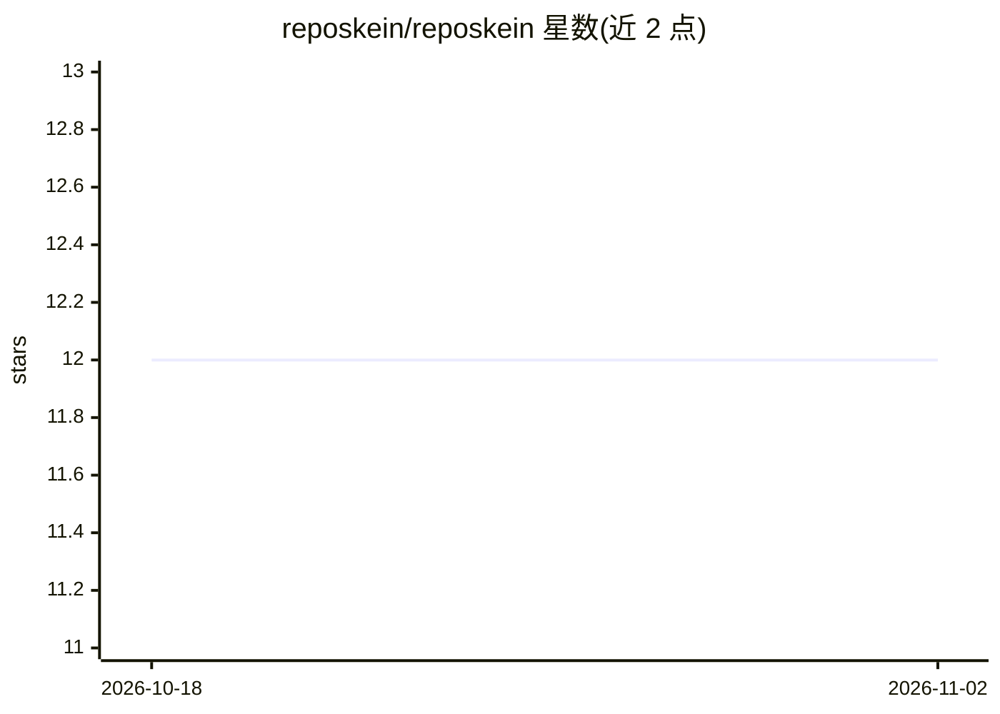

# reposkein/reposkein

⭐ 12 · TypeScript · Apache-2.0 · 推送 2026-11-01 · [GitHub](https://github.com/reposkein/reposkein) · [官网](https://www.npmjs.com/package/@reposkein/mcp) · 个人维护

**为 AI 编程 agent 提供代码库代码图谱的本地 MCP 服务**

RepoSkein 用 Tree-sitter 为代码库构建确定性的 Code Property Graph（文件、类、函数、导入与调用边），通过 MCP 协议接入 Claude Code、Cursor、Codex 等 agent，使 agent 基于结构图谱导航代码而非全文 grep。agent 工作过程中向图节点写入自然语言摘要，摘要随代码提交到 git，形成团队共享记忆。构建路径不含 LLM，图存于 .reposkein/*.jsonl 纯文件，无需数据库；支持 Python/TS/JS/Rust/Go/Java/C# 七种语言，可选 Neo4j 后端与嵌入服务。

## 筛选速览

| 维度 | 判定 | 备注 |
|---|---|---|
| AI 角色 | `ai-ecosystem` | LLM/agent 周边工具 |
| 许可风险 | `permissive` | Apache-2.0 |
| 部署形态 | `library` | 以包/库形式分发 |
| 模型依赖 | — | README 未给出锁定关系 |
| 硬件要求 | — | 无带数字的原话,不猜 |
| 安装摩擦 | `low` | 无编译、无系统依赖或容器化 |
| 成熟度 | — | 结构信号不足 |

## 能力要点

- Tree-sitter 构建确定性代码属性图，构建路径无 LLM
- 通过 MCP 接入任意 MCP 兼容 agent，附 GraphRAG 导航技能
- agent 摘要随 git 提交，形成可共享的团队记忆
- 零基础设施：纯 JSONL 文件存储，无数据库无 Docker

## 适用场景

- 在大型或多语言代码库中让 AI 编程 agent 快速定位调用关系与影响面
- 团队成员共享 agent 积累的代码理解摘要
- 减少 agent 在结构化查询上的上下文窗口消耗

## 场景标签

`知识图谱` `Agent 记忆` · 领域:Agent 开发

## 证据(README 行号)

> L20: It uses Tree-sitter to build a **deterministic Code Property Graph** of your repo — files, classes, functions, impo
> L57: - **An MCP-capable agent** — Claude Code, Cursor, Codex, Zed, etc.

## 星数曲线

2026-10-18 12 → 2026-11-02 12（+0）

---
*卡片 v1 · prompt 1.4 · 生成 2026-11-01 · 置信度 high · 依据 README sha `bc1456e1332d` · [字段定义](../../DATASET.md)*
