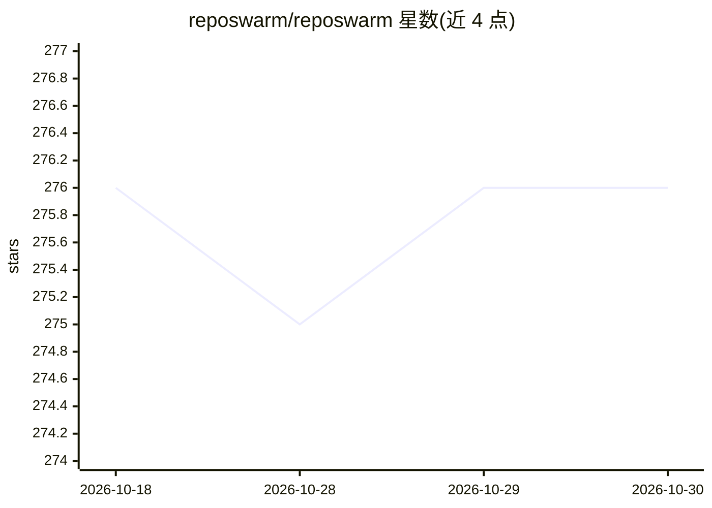

# reposwarm/reposwarm

⭐ 276 · Python · Apache-2.0 · 推送 2026-03-26 · [GitHub](https://github.com/reposwarm/reposwarm) · 组织维护

**多仓库架构发现平台：为 AI agent 生成架构文档上下文**

RepoSwarm 分析整个代码库组合并生成标准化的 .arch.md 架构文档，可用作 AI agent 上下文、入职文档或架构评审材料。流程为：缓存检查→克隆→类型检测→结构分析→提示选择→AI 分析→存储结果。使用 Claude 做代码理解，LLM 提供方可选 Anthropic API、Amazon Bedrock 或 LiteLLM proxy；Git 提供方支持 GitHub、GitLab、CodeCommit、Azure DevOps、Bitbucket。通过 CLI 一键引导 Temporal、API、Worker、UI 等容器化服务，需 Docker 运行；核心引擎为 Temporal 工作流，由 Verbit 黑客松团队开发。

## 筛选速览

| 维度 | 判定 | 备注 |
|---|---|---|
| AI 角色 | `ai-ecosystem` | LLM/agent 周边工具 |
| 许可风险 | `permissive` | Apache-2.0 |
| 部署形态 | `self-host` | docker 或自建部署 |
| 模型依赖 | locked-api |  |
| 硬件要求 | — | 无带数字的原话,不猜 |
| 安装摩擦 | `low` | 无编译、无系统依赖或容器化 |
| 成熟度 | — | 结构信号不足 |

## 能力要点

- 生成标准化 .arch.md 架构文档，作为 AI agent 上下文
- LLM 提供方三选一：Anthropic API / Amazon Bedrock / LiteLLM proxy
- 按仓库类型（后端/前端/移动/库/基础设施）选择专门分析提示词
- 增量分析与 DynamoDB 或文件缓存，支持并行调查多仓库

## 适用场景

- 为 AI agent 准备跨多个代码仓库的架构上下文
- 批量生成团队架构文档与新人入职材料
- 对整个代码库组合做架构评审与文档检索

## 场景标签

 · 领域:开发者工具/架构分析

## 证据(README 行号)

> L5:  AI-powered multi-repo architecture discovery platform
> L58: RepoSwarm automatically analyzes your entire codebase portfolio and generates standardized architecture documentati
> L64: - 🔍 **AI-Powered Analysis** — Uses Claude to deeply understand codebases

## 星数曲线

2026-10-18 276 → 2026-10-30 276（+0）

---
*卡片 v1 · prompt 1.4 · 生成 2026-10-22 · 置信度 high · 依据 README sha `17560afd22cd` · [字段定义](../../DATASET.md)*
