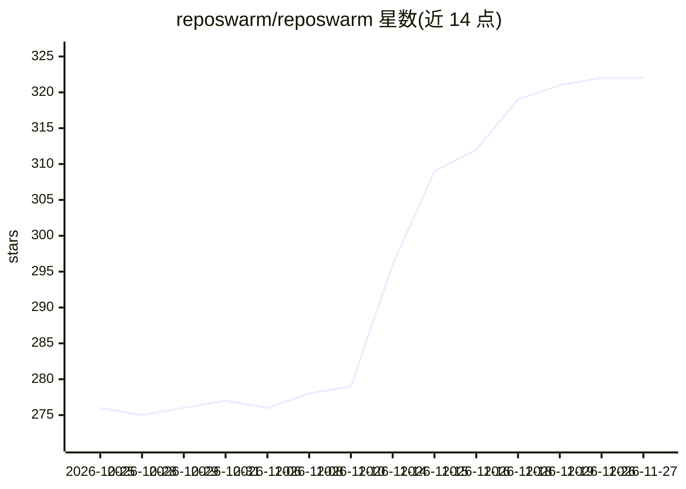

# reposwarm/reposwarm

⭐ 322 · Python · Apache-2.0 · 推送 2026-11-22 · [GitHub](https://github.com/reposwarm/reposwarm) · 组织维护

**为 AI 编码代理分析多仓库并生成统一架构文档**

RepoSwarm 分析多个代码仓库，生成标准化 `.arch.md` 架构文件并提交到共享 hub 仓库，供编码代理作为上下文读取；同一输出可用于新人上手与架构评审。分析通过 Claude（Anthropic API、Amazon Bedrock 或 LiteLLM 代理）执行，基于 Temporal 工作流运行，支持按提交/分支/prompt 版本决定增量重分析，结果缓存在 DynamoDB 或本地文件。需 Docker 运行环境与 Git；生成结果需人工复核。

## 筛选速览

| 维度 | 判定 | 备注 |
|---|---|---|
| AI 角色 | `ai-ecosystem` | LLM/agent 周边工具 |
| 许可风险 | `permissive` | Apache-2.0 |
| 部署形态 | `self-host` | docker 或自建部署 |
| 模型依赖 | locked-api |  |
| 硬件要求 | — | 无带数字的原话,不猜 |
| 安装摩擦 | `low` | 无编译、无系统依赖或容器化 |
| 成熟度 | — | 结构信号不足 |

## 能力要点

- 生成标准化 .arch.md 架构文档并集中到结果 hub 仓库
- 支持 GitHub、GitLab、CodeCommit、Azure DevOps、Bitbucket 五种 Git 提供商
- 模型后端可选 Anthropic API、Amazon Bedrock 或 LiteLLM 代理
- 按仓库类型（后端/前端/移动/基础设施等）使用专用分析 prompt

## 适用场景

- 给 AI 编码代理提供跨仓库的架构上下文
- 新成员入职时快速了解多仓库代码库结构
- 定期开展架构评审并跟踪文档更新

## 场景标签

 · 领域:开发者工具/架构文档

## 证据(README 行号)

> L3: RepoSwarm analyzes repositories and generates standardized `.arch.md` architecture files.
> L82: - 🔍 **AI-Powered Analysis** — Uses Claude to deeply understand codebases
> L14: - **Runs with Temporal workflows.** Local setup requires running Docker, Docker Compose and Git.

## 星数曲线

2026-10-25 276 → 2026-11-27 322（+46）

---
*卡片 v1 · prompt 1.4 · 生成 2026-11-25 · 置信度 high · 依据 README sha `3cc8918c8e95` · [字段定义](../../DATASET.md)*
