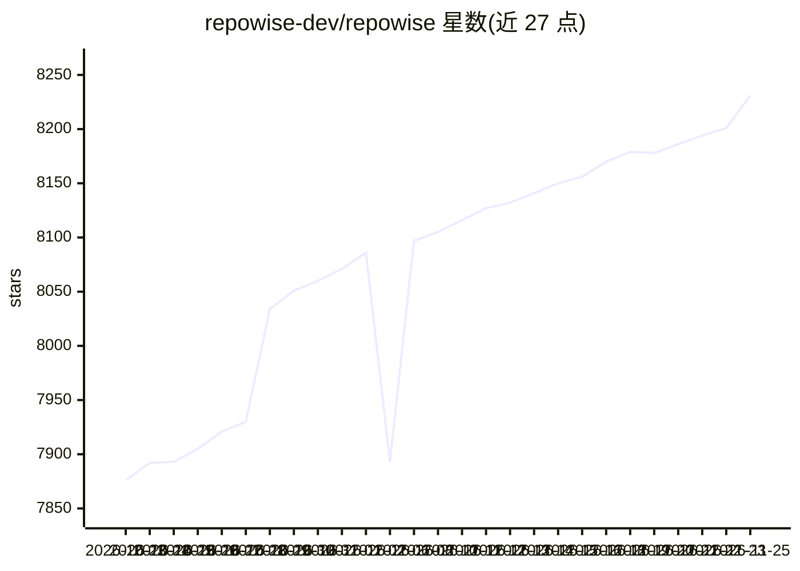

# repowise-dev/repowise

⭐ 8,231 · Python · AGPL-3.0 · 推送 2026-11-23 · [GitHub](https://github.com/repowise-dev/repowise) · [官网](https://repowise.dev) · 组织维护 · 中文 README

**本地代码库索引与 MCP 工具：供编码 Agent 免重复读代码、供人看健康度**

在本地对仓库的代码、git 历史、测试与决策建一次索引，通过 MCP 向 Claude Code、Codex、Cursor 等 Agent 提供 10 个任务化工具，回答调用关系、变更风险、测试覆盖等问题；索引与图、健康分、死代码检测均为确定性计算，建索引无需 API key。同时提供本地仪表盘（需 Node 20+）展示架构图、健康评分、重构建议与生成的 wiki 文档。通过 uv/pipx 安装，需 Python 3.11+ 与 Git；另提供 repowise.dev 托管版。

## 筛选速览

| 维度 | 判定 | 备注 |
|---|---|---|
| AI 角色 | `ai-ecosystem` | LLM/agent 周边工具 |
| 许可风险 | `dual` | AGPL-3.0 |
| 部署形态 | `self-host` | docker 或自建部署 |
| 模型依赖 | local-ok | 支持本地模型 |
| 硬件要求 | — | 无带数字的原话,不猜 |
| 安装摩擦 | `low` | 无编译、无系统依赖或容器化 |
| 成熟度 | — | 结构信号不足 |

## 能力要点

- 10 个 MCP 工具供编码 Agent 查询调用图、风险、测试与代码归属
- 跨 29 种语言的调用图与架构图，索引无需 API key、零 LLM 调用
- 1-10 分代码健康评分（53 个确定性检测器）与排序的修复队列
- 从 ADR、注释、commit/PR 历史与 Agent 会话挖掘架构决策

## 适用场景

- 让编码 Agent 不再反复 grep 和打开文件来理解仓库
- 评估改动的影响范围并确定应运行的测试
- 定位代码库中的技术债、死代码与性能问题
- 生成并维护模块级文档，检测文档与代码的漂移

## 场景标签

 · 领域:开发者工具/代码智能

## 证据(README 行号)

> L7:  Repowise indexes your code, git history, tests and decisions once, on your machine.
> L21: 29 languages · Claude Code, Codex, Cursor and any MCP host · free and open source
> L79: - Your agent gets **ten task-shaped MCP tools**. Ask about several files at once

## 星数曲线

2026-10-23 7,876 → 2026-11-25 8,231（+355）

---
*卡片 v1 · prompt 1.4 · 生成 2026-11-23 · 置信度 mid · 依据 README sha `3ac435e0dcbd` · [字段定义](../../DATASET.md)*
