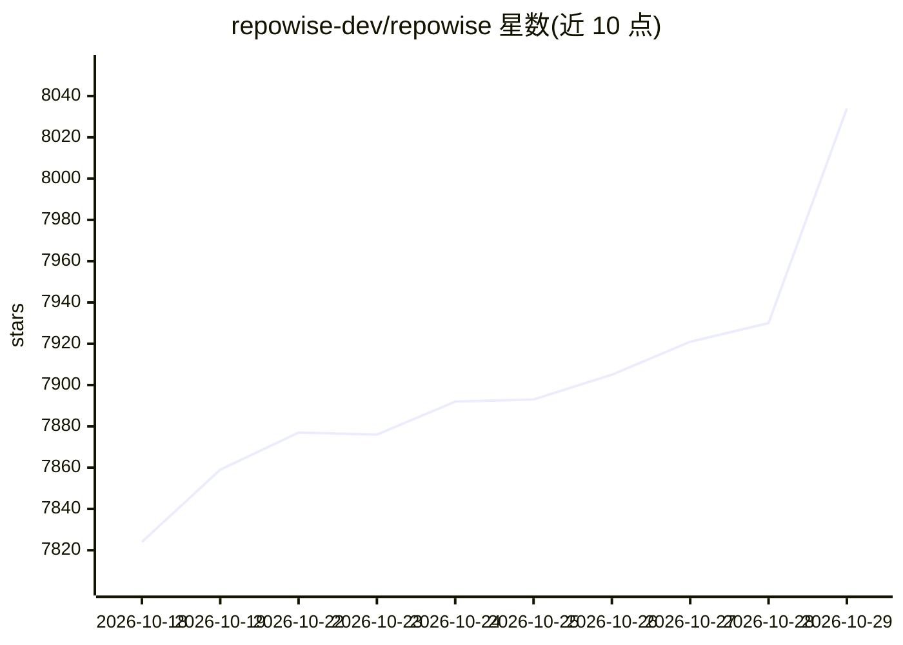

# repowise-dev/repowise

⭐ 8,034 · Python · AGPL-3.0 · 推送 2026-10-28 · [GitHub](https://github.com/repowise-dev/repowise) · [官网](https://repowise.dev) · 组织维护

**本地代码库索引工具：为开发者与编码代理提供代码健康、调用图与变更风险**

Repowise 在本机一次性索引代码、调用图、git 历史、测试、文档与设计决策，形成单一索引，供开发者与编码代理查询。提供 10 个面向任务的 MCP 工具，接入 Claude Code、Codex、Cursor 等 MCP 宿主；另含本地仪表盘、CLI、CI 门禁（SARIF）与跨仓库契约检查。核心分析（图、风险、健康分、死代码）零 LLM 调用、无需 API key，输出确定性。AGPL-3.0 开源，另有托管版与商业层（组织级功能）。安装方式为 pip/pipx/uv，或让代理按 setup 文档自动安装。

## 筛选速览

| 维度 | 判定 | 备注 |
|---|---|---|
| AI 角色 | `ai-ecosystem` | LLM/agent 周边工具 |
| 许可风险 | `dual` | AGPL-3.0 |
| 部署形态 | `self-host` | docker 或自建部署 |
| 模型依赖 | — | README 未给出锁定关系 |
| 硬件要求 | — | 无带数字的原话,不猜 |
| 安装摩擦 | `low` | 无编译、无系统依赖或容器化 |
| 成熟度 | — | 结构信号不足 |

## 能力要点

- 一次索引 27 种解析语言的调用图、git 历史与测试，增量更新
- 10 个任务型 MCP 工具接入 Claude Code、Codex、Cursor 等代理
- 53 个确定性检测器的代码健康分（1-10），经真实缺陷历史验证
- 图/风险/健康/测试/死代码分析零 LLM 调用，无需 API key

## 适用场景

- 让编码代理在改代码前查询调用关系与影响范围
- 在 CI 中对 PR 做变更风险评级与补丁覆盖率门禁
- 按排名队列偿还技术债、识别死代码与性能问题
- 跨仓库匹配 API 契约并在破坏性变更前报警

## 场景标签

 · 领域:开发者工具/代码智能

## 证据(README 行号)

> L6: decisions once, on your machine. Then you and your coding agent ask it things:
> L175: Repowise gives Claude Code, Codex, Cursor, VS Code and any other MCP host

## 星数曲线

2026-10-18 7,824 → 2026-10-29 8,034（+210）

---
*卡片 v1 · prompt 1.4 · 生成 2026-10-20 · 置信度 mid · 依据 README sha `8680460e47b8` · [字段定义](../../DATASET.md)*
