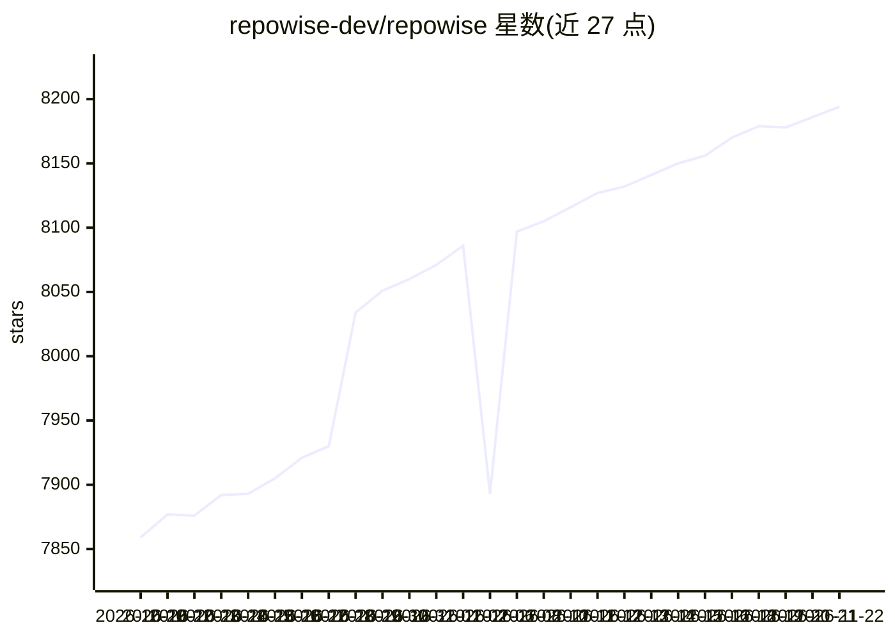

# repowise-dev/repowise

⭐ 8,194 · Python · AGPL-3.0 · 推送 2026-11-21 · [GitHub](https://github.com/repowise-dev/repowise) · [官网](https://repowise.dev) · 组织维护 · 中文 README

**给编码 agent 与开发者提供代码库索引与代码健康分析的 MCP 工具**

在本机对代码、git 历史、测试与决策建立一次索引，提供 29 种语言的调用图、架构图、代码健康评分（1-10，53 个确定性检测器）、死代码检测、变更风险与影响面分析、从 ADR/commit/PR 挖掘的决策记录，以及生成文档。通过 MCP 向 Claude Code、Codex、Cursor 等 agent 提供 10 个任务型工具，同时提供本地 dashboard 展示带引用的回答。索引零 LLM 调用、无需 API key；语义搜索与模型生成文档为可选功能。需要 Python 3.11+、Git，dashboard 需 Node 20+。

## 筛选速览

| 维度 | 判定 | 备注 |
|---|---|---|
| AI 角色 | `ai-ecosystem` | LLM/agent 周边工具 |
| 许可风险 | `dual` | AGPL-3.0 |
| 部署形态 | `self-host` | docker 或自建部署 |
| 模型依赖 | local-ok | 支持本地模型 |
| 硬件要求 | — | 无带数字的原话,不猜 |
| 安装摩擦 | `low` | 无编译、无系统依赖或容器化 |
| 成熟度 | — | 结构信号不足 |

## 能力要点

- 10 个 MCP 工具让 agent 一次获取调用者、风险、测试与归属信息
- 53 个确定性检测器生成 1-10 分代码健康评分与修复优先级队列
- 符号级变更影响面：调用者、协同变更缺失文件、覆盖测试
- 从 ADR、注释、commit、PR 与 agent 会话挖掘并追踪决策

## 适用场景

- 让编码 agent 不再反复 grep/读文件，直接查询代码库索引
- 合并前评估某个 commit/PR 可能破坏哪些调用者与测试
- 定位死代码、性能问题与应优先修复的文件
- 为新成员生成模块 wiki 并检查文档漂移

## 场景标签

`代码审查` · 领域:编码与开发

## 证据(README 行号)

> L7:  Repowise indexes your code, git history, tests and decisions once, on your machine.
> L79: - Your agent gets **ten task-shaped MCP tools**. Ask about several files at once
> L122: Cited answers and charts from the dashboard, or the same answers through MCP for

## 星数曲线

2026-10-20 7,859 → 2026-11-22 8,194（+335）

---
*卡片 v1 · prompt 1.4 · 生成 2026-11-22 · 置信度 mid · 依据 README sha `dfe5d2703920` · [字段定义](../../DATASET.md)*
