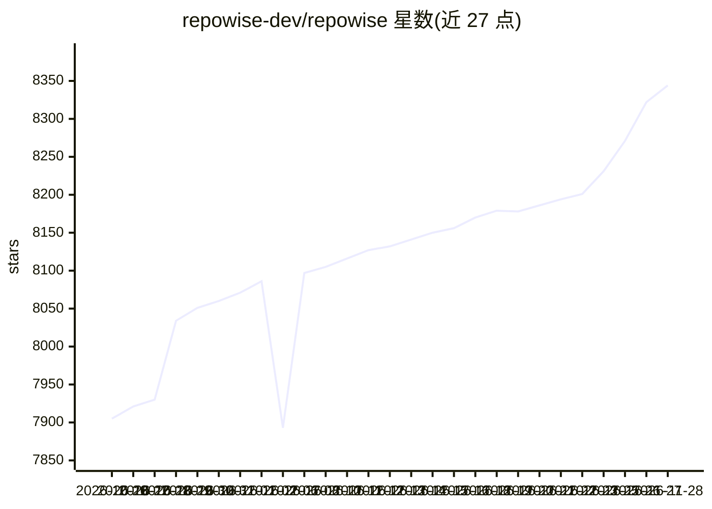

# repowise-dev/repowise

⭐ 8,344 · Python · AGPL-3.0 · 推送 2026-11-27 · [GitHub](https://github.com/repowise-dev/repowise) · [官网](https://repowise.dev) · 组织维护

**为开发者与编码 Agent 提供代码库索引与健康分析的本地工具**

在本地对代码、git 历史、测试与决策建立一次索引，Agent 通过 MCP 工具查询索引而非反复 grep 与打开文件；同时提供本地仪表盘展示调用图、变更风险、代码健康评分、死代码与架构图。索引路径不调用 LLM、无需 API key；文档生成与语义搜索可选接入模型。支持 29 种语言，通过 uv/pipx 安装，服务仪表盘需 Node 20+。另提供 repowise.dev 托管版与 PR 审查机器人。

## 筛选速览

| 维度 | 判定 | 备注 |
|---|---|---|
| AI 角色 | `ai-ecosystem` | LLM/agent 周边工具 |
| 许可风险 | `dual` | AGPL-3.0 |
| 部署形态 | `self-host` | docker 或自建部署 |
| 模型依赖 | local-ok | 支持本地模型 |
| 硬件要求 | — | 无带数字的原话,不猜 |
| 安装摩擦 | `low` | 无编译、无系统依赖或容器化 |
| 成熟度 | — | 结构信号不足 |

## 能力要点

- 十个任务型 MCP 工具，一次返回调用者、风险、测试与归属等信息
- 基于调用图与 git 历史的确定性分析，索引无需 API key
- 59 个确定性检测器生成 1-10 文件健康评分，与 bug 历史对照校验
- 支持 Claude Code、Codex、Cursor 及任意 MCP host

## 适用场景

- 让编码 Agent 少打开文件、更快获得代码库相关回答
- 评估改动的影响范围（调用者、共变文件、相关测试）
- 生成模块/文件级文档并检测文档与代码的漂移
- 按修复优先级队列定位技术债与死代码

## 场景标签

`编码 Agent` · 领域:编码与开发

## 证据(README 行号)

> L7:  Repowise indexes your code, git history, tests and decisions once, on your machine.
> L21: 29 languages · Claude Code, Codex, Cursor and any MCP host · free and open source
> L44: The agent installs Repowise, indexes the repo with no API key, connects itself to

## 星数曲线

2026-10-26 7,905 → 2026-11-28 8,344（+439）

---
*卡片 v1 · prompt 1.4 · 生成 2026-11-28 · 置信度 mid · 依据 README sha `2ddb10af4e40` · [字段定义](../../DATASET.md)*
