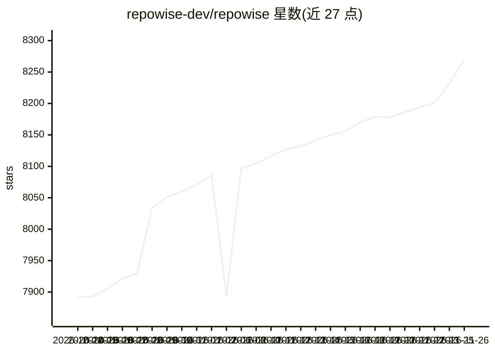

# repowise-dev/repowise

⭐ 8,271 · Python · AGPL-3.0 · 推送 2026-11-25 · [GitHub](https://github.com/repowise-dev/repowise) · [官网](https://repowise.dev) · 组织维护 · 中文 README

**为编码 agent 与开发者提供代码库索引与代码健康分析**

在本地为代码库建立一次索引（调用图、git 历史、测试、架构决策），编码 agent 通过 MCP 工具查询该索引而非反复 grep 和读文件；同时提供本地仪表盘展示代码健康评分、变更风险、死代码、重构计划与从 ADR/提交/PR 中挖掘的决策记录。图形与评分计算不经 LLM，答案确定性可复现；文档生成可选接入模型。通过 uv/pipx 安装，提供托管版 repowise.dev。

## 筛选速览

| 维度 | 判定 | 备注 |
|---|---|---|
| AI 角色 | `ai-ecosystem` | LLM/agent 周边工具 |
| 许可风险 | `dual` | AGPL-3.0 |
| 部署形态 | `self-host` | docker 或自建部署 |
| 模型依赖 | local-ok | 支持本地模型 |
| 硬件要求 | — | 无带数字的原话,不猜 |
| 安装摩擦 | `low` | 无编译、无系统依赖或容器化 |
| 成熟度 | — | 结构信号不足 |

## 能力要点

- 十个任务形态的 MCP 工具，一次调用返回调用者、风险、测试与归属信息
- 跨 29 种语言的调用图、架构图与自动生成 wiki，无 API key 即可索引
- 1-10 分代码健康评分基于 59 个确定性检测器，并对照真实 bug 历史验证
- distill 命令在 agent 读取前裁剪命令输出，expand 可恢复被裁内容

## 适用场景

- 让 Claude Code/Cursor 等 agent 查询索引而非重读整个代码库
- 合并前评估一次改动影响的调用者与缺失测试
- 按修复优先级队列清理代码债务与死代码
- 从提交与 PR 历史沉淀架构决策并检测文档漂移

## 场景标签

 · 领域:开发者工具/代码智能

## 证据(README 行号)

> L7:  Repowise indexes your code, git history, tests and decisions once, on your machine.
> L79: - Your agent gets **ten task-shaped MCP tools**. Ask about several files at once
> L122: Cited answers and charts from the dashboard, or the same answers through MCP for

## 星数曲线

2026-10-24 7,892 → 2026-11-26 8,271（+379）

---
*卡片 v1 · prompt 1.4 · 生成 2026-11-26 · 置信度 mid · 依据 README sha `5ae0e8e1502c` · [字段定义](../../DATASET.md)*
