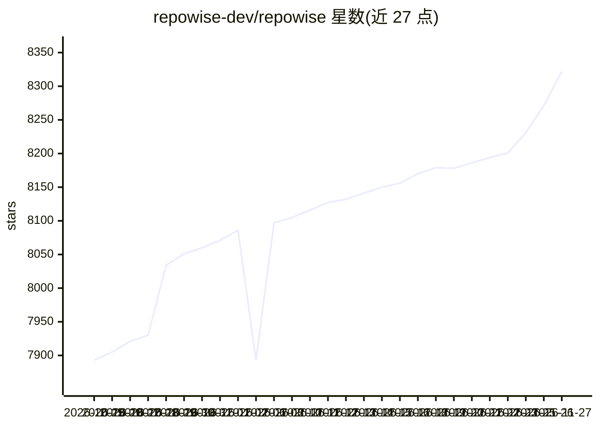

# repowise-dev/repowise

⭐ 8,322 · Python · AGPL-3.0 · 推送 2026-11-26 · [GitHub](https://github.com/repowise-dev/repowise) · [官网](https://repowise.dev) · 组织维护

**本地索引代码库的 MCP 服务：为编码 agent 与开发者提供代码健康与架构分析**

在本地对代码、git 历史、测试与决策建立一次索引，编码 agent 通过 MCP 工具查询索引而非反复检索文件；图、风险、健康、测试与死代码分析均零 LLM 调用、无需 API key。提供十个 MCP 工具、本地仪表盘（需 Node 20+）、可选 ollama 本地语义搜索，另提供云端托管版与 PR bot。支持 29 种语言的调用图，安装需 Python 3.11+ 与 Git。

## 筛选速览

| 维度 | 判定 | 备注 |
|---|---|---|
| AI 角色 | `ai-ecosystem` | LLM/agent 周边工具 |
| 许可风险 | `dual` | AGPL-3.0 |
| 部署形态 | `self-host` | docker 或自建部署 |
| 模型依赖 | local-ok | 支持本地模型 |
| 硬件要求 | — | 无带数字的原话,不猜 |
| 安装摩擦 | `low` | 无编译、无系统依赖或容器化 |
| 成熟度 | — | 结构信号不足 |

## 能力要点

- 十个任务型 MCP 工具，一次调用返回调用者、风险、测试与所有权
- 调用图覆盖 29 种语言，图与 git 推导的分析零 LLM 调用、无需 API key
- 59 个确定性检测器给出 1-10 文件健康分，并用真实 bug 历史自校验
- repowise distill 裁剪命令输出，expand 可恢复被裁剪内容

## 适用场景

- 让 Claude Code/Cursor 等编码 agent 直接查询代码库索引以减少文件读取
- 评估 PR 变更风险并确定应运行哪些测试
- 生成模块 wiki 并检测文档与代码的漂移
- 排队修复代码健康分最低的文件与死代码

## 场景标签

`编码 Agent` `语义搜索` · 领域:编码与开发

## 证据(README 行号)

> L7:  Repowise indexes your code, git history, tests and decisions once, on your machine.
> L21: 29 languages · Claude Code, Codex, Cursor and any MCP host · free and open source
> L48: uv tool install repowise          # needs Python 3.11+ and Git. Or: pipx install repowise

## 星数曲线

2026-10-25 7,893 → 2026-11-27 8,322（+429）

---
*卡片 v1 · prompt 1.4 · 生成 2026-11-27 · 置信度 mid · 依据 README sha `969485327fc0` · [字段定义](../../DATASET.md)*
