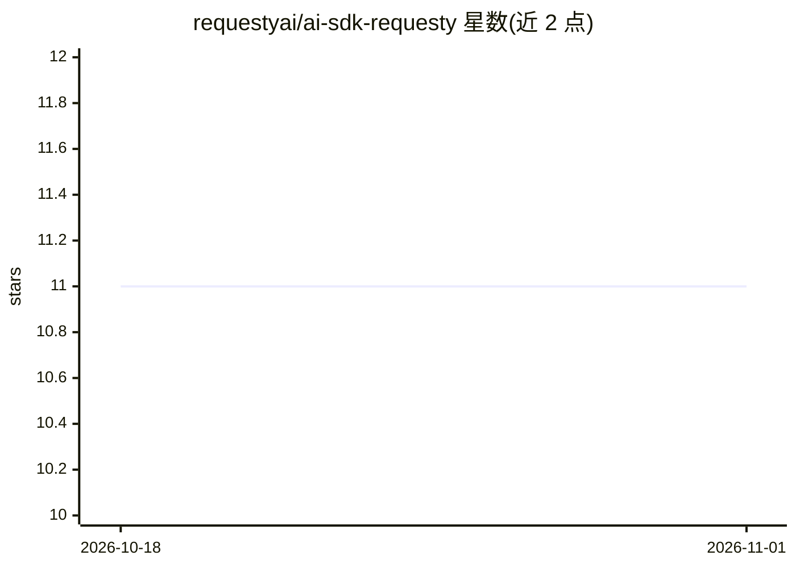

# requestyai/ai-sdk-requesty

⭐ 11 · TypeScript · Apache-2.0 · 推送 2026-10-22 · [GitHub](https://github.com/requestyai/ai-sdk-requesty) · [官网](https://www.npmjs.com/package/@requesty/ai-sdk) · 组织维护

**Vercel AI SDK 的 Requesty 模型接入包：访问 300+ LLM**

Requesty 官方为 Vercel AI SDK v5 提供的 provider 集成包，通过 Requesty 路由 API（router.requesty.ai/v1）访问 OpenAI、Anthropic、Google、Meta、DeepSeek 等 300 余种模型。支持文本生成、流式输出、工具调用、对象生成、多步工具调用与类型安全工具结果；可配置 reasoningEffort 推理档位、自定义元数据（tags/user_id/trace_id）用于 Requesty 面板用量分析。要求 Node.js 18+，v4 兼容需锁定 @0.0.9 旧版本。

## 筛选速览

| 维度 | 判定 | 备注 |
|---|---|---|
| AI 角色 | `ai-ecosystem` | LLM/agent 周边工具 |
| 许可风险 | `permissive` | Apache-2.0 |
| 部署形态 | `library` | 以包/库形式分发 |
| 模型依赖 | — | README 未给出锁定关系 |
| 硬件要求 | — | 无带数字的原话,不猜 |
| 安装摩擦 | `low` | 无编译、无系统依赖或容器化 |
| 成熟度 | — | 结构信号不足 |

## 能力要点

- 接入 Requesty 路由下的 300+ 模型（OpenAI/Anthropic/Google/Meta/DeepSeek 等）
- 支持 AI SDK v5 的文本生成、流式、工具调用、对象生成与多步工具调用
- reasoningEffort 四档推理力度与 token 预算字符串配置
- tags/user_id/trace_id 等元数据用于 Requesty 面板用量追踪

## 适用场景

- 在 Vercel AI SDK 应用中通过单一 API key 调用多家厂商模型
- 为 AI agent 与客服机器人构建工具调用流程
- 在 Requesty 面板按用户与工作流追踪 LLM 用量

## 场景标签

`模型网关` · 领域:Agent 开发

## 证据(README 行号)

> L1: # Requesty Provider for AI SDK v5
> L5: The Requesty provider for the AI SDK v5 gives access to over 300 large language models through the Requesty chat and

## 星数曲线

2026-10-18 11 → 2026-11-01 11（+0）

---
*卡片 v1 · prompt 1.4 · 生成 2026-11-01 · 置信度 high · 依据 README sha `a3a977d4a9f2` · [字段定义](../../DATASET.md)*
