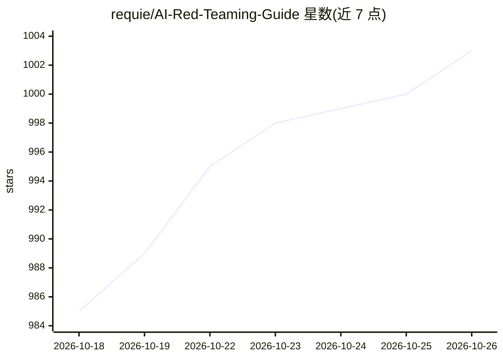

# requie/AI-Red-Teaming-Guide

⭐ 1,003 · 推送 2026-10-11 · [GitHub](https://github.com/requie/AI-Red-Teaming-Guide) · 个人维护 · 中文 README

**AI 系统红队测试与安全评估的综合指南**

面向安全团队、AI/ML 工程师、风险管理者与合规人员的 AI 红队知识指南：定义 AI 红队核心概念（越狱、提示注入、模型抽取、数据投毒等），整理 2023–2026 年安全事件案例、监管驱动因素（欧盟 AI 法案、美国行政令），并系统介绍 NIST AI RMF（GOVERN/MAP/MEASURE/MANAGE）与 OWASP GenAI 红队指南等框架。内容以文档形式提供，含英/西/中/法多语言版本，另在工具章节列举红队工具（相关安装命令属所列工具，非本指南自身的安装途径）。

## 筛选速览

| 维度 | 判定 | 备注 |
|---|---|---|
| AI 角色 | `ai-knowledge` | 知识聚合/清单类 |
| 许可风险 | `none` | — |
| 部署形态 | `library` | 以包/库形式分发 |
| 模型依赖 | — | README 未给出锁定关系 |
| 硬件要求 | — | 无带数字的原话,不猜 |
| 安装摩擦 | `medium` | 含编译或系统依赖之一 |
| 成熟度 | — | 结构信号不足 |

## 能力要点

- 覆盖 NIST AI RMF、OWASP GenAI 红队指南、MITRE ATLAS 等框架
- 整理 2023–2026 年 AI 安全事件案例（含 agent 劫持、提示注入相关 CVE）
- 定义红队/蓝队/紫队、越狱、提示注入等核心术语
- 提供英/西/中/法四语版本

## 适用场景

- 作为安全团队搭建 AI 红队测试项目的入门与参考材料
- 了解 AI 红队相关监管要求与合规框架
- 查阅 AI 安全事件案例与攻击技术分类

## 场景标签

`网络安全` · 领域:学习与行业

## 证据(README 行号)

> L7: **A comprehensive guide to adversarial testing and security evaluation of AI systems, helping organizations identify
> L53: - 🔐 **Security Teams** implementing AI security testing programs

## 星数曲线

2026-10-18 985 → 2026-10-26 1,003（+18）

---
*卡片 v1 · prompt 1.4 · 生成 2026-10-21 · 置信度 mid · 依据 README sha `8893190dde78` · [字段定义](../../DATASET.md)*
