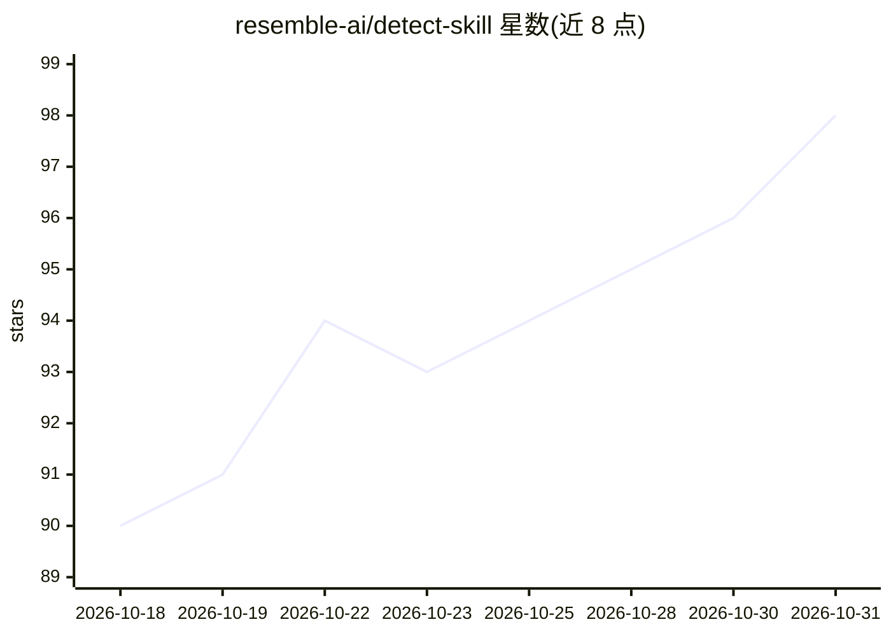

# resemble-ai/detect-skill

⭐ 98 · Apache-2.0 · 推送 2026-09-23 · [GitHub](https://github.com/resemble-ai/detect-skill) · [官网](https://resemble.ai) · 组织维护

**教 AI agent 调用 Resemble API 做 deepfake 检测的技能文件**

由 Resemble AI 维护的 agent 技能（单个 SKILL.md）：教支持 markdown 技能的 AI agent 直接用 curl 调用 Resemble Detect、Intelligence 与 Agent Detection REST API，实现音频/图像/视频合成检测、AI 文本检测（≥25 词）、音频来源平台追踪、说话人信息提取与网站访客人机识别。含决策树、工作流模板、错误处理指引；无需 MCP 服务器，需 Resemble API key 与 curl，本地文件上传上限 150 MB。

## 筛选速览

| 维度 | 判定 | 备注 |
|---|---|---|
| AI 角色 | `ai-native` | 本体是模型或模型工具 |
| 许可风险 | `permissive` | Apache-2.0 |
| 部署形态 | `library` | 以包/库形式分发 |
| 模型依赖 | — | README 未给出锁定关系 |
| 硬件要求 | — | 无带数字的原话,不猜 |
| 安装摩擦 | `low` | 无编译、无系统依赖或容器化 |
| 成熟度 | — | 结构信号不足 |

## 能力要点

- 音频/图像/视频 deepfake 检测（标签、分数、可视化）
- AI 文本检测：输出 prediction/confidence，少于 25 词直接拒绝
- 音频来源追踪可指认 ElevenLabs/Resemble 等合成平台
- curl 直调 REST API，MCP 服务器仅为可选配套

## 适用场景

- 让我的 agent 判断一段音频或视频是否为 AI 合成
- 检测文章、邮件、评论是否由 AI 生成
- 分析检测完成后的结果并提出追问
- 查看网站流量中有多少来自 AI agent

## 场景标签

 · 领域:AI 安全/媒体检测

## 证据(README 行号)

> L5: Give any AI agent the ability to detect AI-generated audio, images, video, and text, analyze completed detection res
> L37: |**Deepfake Detection**|Analyze audio, image, and video for synthetic manipulation with labels, scores, status, and

## 星数曲线

2026-10-18 90 → 2026-10-31 98（+8）

---
*卡片 v1 · prompt 1.4 · 生成 2026-10-23 · 置信度 high · 依据 README sha `e2246fbd76fe` · [字段定义](../../DATASET.md)*
