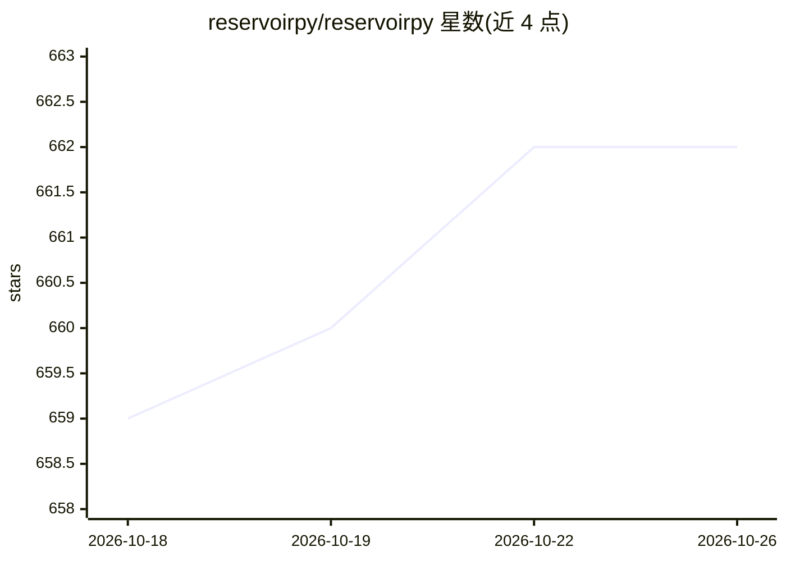

# reservoirpy/reservoirpy

⭐ 662 · Python · MIT · 推送 2026-10-22 · [GitHub](https://github.com/reservoirpy/reservoirpy) · [官网](https://reservoirpy.readthedocs.io/) · 组织维护

**Python 储备计算库：构建回声状态网络做时间序列预测与分类**

面向开发者和科研人员的储备计算（Reservoir Computing）Python 库，核心是回声状态网络（ESN）。支持多储备池复杂架构、深度储备池、反馈回路、离线与在线训练、序列并行化与稀疏矩阵计算；内置 Intrinsic Plasticity、Local Plasticity、NVAR 等学习规则，可接入 scikit-learn 模型，并提供基于 hyperopt 的超参数探索工具。附 Colab 教程与论文复现示例，可处理 Mackey-Glass 等混沌时间序列预测任务。由法国 Inria 研究机构 Mnemosyne 团队开发维护。

## 筛选速览

| 维度 | 判定 | 备注 |
|---|---|---|
| AI 角色 | `ai-native` | 本体是模型或模型工具 |
| 许可风险 | `permissive` | MIT |
| 部署形态 | `library` | 以包/库形式分发 |
| 模型依赖 | — | README 未给出锁定关系 |
| 硬件要求 | — | 无带数字的原话,不猜 |
| 安装摩擦 | `low` | 无编译、无系统依赖或容器化 |
| 成熟度 | — | 结构信号不足 |

## 能力要点

- 多储备池/深度储备池架构、反馈回路、离线与在线训练
- 高级学习规则：Intrinsic Plasticity、Local Plasticity、NVAR
- 基于 hyperopt 的超参数图形化探索
- 提供 Jax 后端与 scikit-learn 接口

## 适用场景

- 时间序列预测与分类任务建模
- 复现储备计算领域论文方法
- 科研中进行回声状态网络实验与调参

## 场景标签

 · 领域:机器学习/时间序列分析

## 证据(README 行号)

> L1: **Simple and flexible library for Reservoir Computing architectures like Echo State Networks (ESN).**
> L39: ### An example on chaotic timeseries prediction (Mackey-Glass)
> L113: This package is developed and supported by Inria at Bordeaux, France in Mnemosyne group. Inria is a French Researc

## 星数曲线

2026-10-18 659 → 2026-10-26 662（+3）

---
*卡片 v1 · prompt 1.4 · 生成 2026-10-21 · 置信度 high · 依据 README sha `a72ca796d7e7` · [字段定义](../../DATASET.md)*
