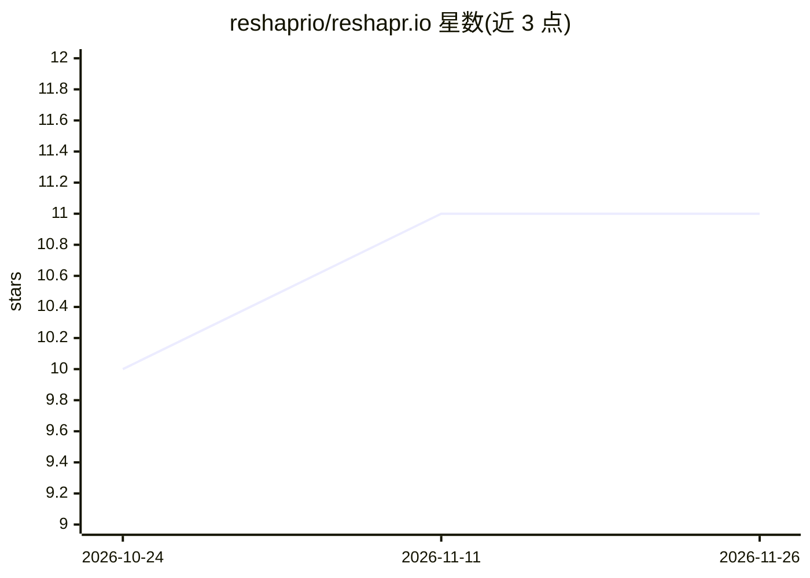

# reshaprio/reshapr.io

⭐ 11 · JavaScript · Apache-2.0 · 推送 2026-11-25 · [GitHub](https://github.com/reshaprio/reshapr.io) · [官网](https://reshapr.io/) · 组织维护

**reShapr 产品文档网站的构建与贡献指南（Docusaurus）**

该仓库是 reShapr 的官网与文档源码，使用 Docusaurus 静态网站生成器构建。README 内容限于网站开发流程：要求 Node.js 20 以上与 npm，通过 git clone、npm install 安装依赖（经 patch-package 打补丁），npm run start 启动本地开发服务器，并说明使用 Conventional Commits 提交与清理构建缓存的步骤。README 未描述 reShapr 产品本身的功能细节，仅仓库主题标签表明其与 API AI 化、MCP、gRPC、LLM 相关。

## 筛选速览

| 维度 | 判定 | 备注 |
|---|---|---|
| AI 角色 | `ai-ecosystem` | LLM/agent 周边工具 |
| 许可风险 | `permissive` | Apache-2.0 |
| 部署形态 | `library` | 以包/库形式分发 |
| 模型依赖 | — | README 未给出锁定关系 |
| 硬件要求 | — | 无带数字的原话,不猜 |
| 安装摩擦 | `low` | 无编译、无系统依赖或容器化 |
| 成熟度 | — | 结构信号不足 |

## 能力要点

- 基于 Docusaurus 静态网站生成器构建
- 通过 patch-package 在 postinstall 应用兼容性补丁
- 提供本地开发、提交规范（Conventional Commits）与缓存清理流程

## 适用场景

- 本地搭建并预览 reShapr 文档站
- 向文档站点提交内容修改的 Pull Request

## 场景标签

 · 领域:AI 基础设施/开发者文档

## 证据(README 行号)

> L2: This website is built using Docusaurus, a modern static website generator.
> L12: 1. Fork the repository on GitHub

## 星数曲线

2026-10-24 10 → 2026-11-26 11（+1）

---
*卡片 v1 · prompt 1.4 · 生成 2026-11-18 · 置信度 low · 依据 README sha `41ade9b374fd` · [字段定义](../../DATASET.md)*
