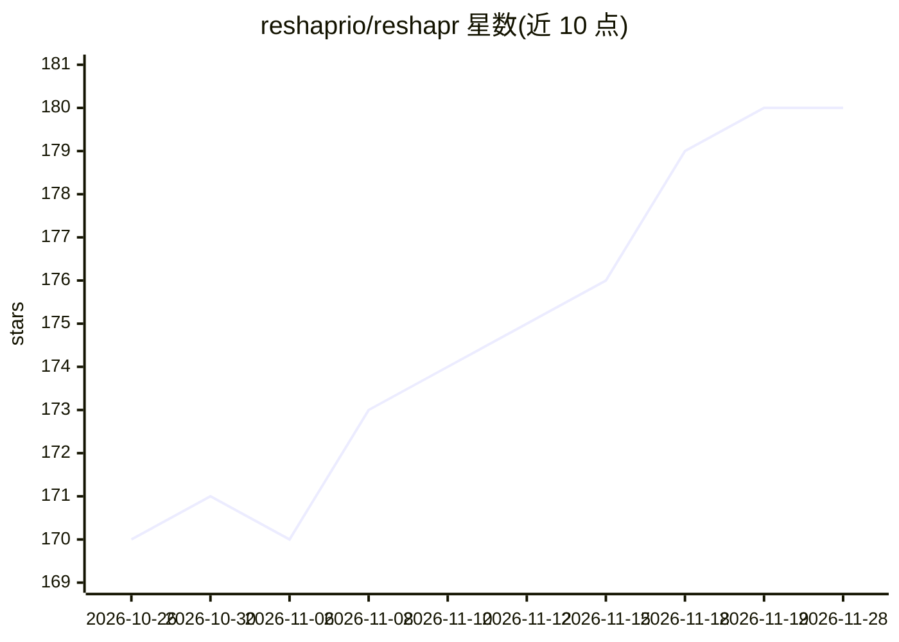

# reshaprio/reshapr

⭐ 180 · Java · Apache-2.0 · 推送 2026-11-27 · [GitHub](https://github.com/reshaprio/reshapr) · [官网](https://reshapr.io) · 组织维护

**把现有 API 转为 MCP 工具的运行时，服务 AI Agent 接入**

reShapr 是一个开源运行时，将既有 REST/GraphQL/gRPC 服务转换为可治理、可发现、上下文优化的 MCP 工具，无需重写 API。核心机制是 Context Control：在负载送达 LLM 前过滤与精简，缓解 Context Overload；导入 OpenAPI 契约即可生成 MCP Server，无需为每个 API 单独搭建 MCP 服务器。提供 npm 安装的 CLI、Docker Compose 本地平台、在线沙盒 try.reshapr.io 与 Web UI。

## 筛选速览

| 维度 | 判定 | 备注 |
|---|---|---|
| AI 角色 | `ai-ecosystem` | LLM/agent 周边工具 |
| 许可风险 | `permissive` | Apache-2.0 |
| 部署形态 | `library` | 以包/库形式分发 |
| 模型依赖 | — | README 未给出锁定关系 |
| 硬件要求 | — | 无带数字的原话,不猜 |
| 安装摩擦 | `low` | 无编译、无系统依赖或容器化 |
| 成熟度 | — | 结构信号不足 |

## 能力要点

- 将 REST/GraphQL/gRPC API 自动转换为 LLM 友好的 MCP 工具
- Context Control 在负载到达 LLM 前过滤与精简
- 导入 OpenAPI 契约即可生成 MCP Server，零重写
- 提供 CLI、Docker Compose 平台与在线沙盒三种上手方式

## 适用场景

- 把公司现有 API 快速暴露给 AI Agent 调用
- 为多协议服务统一生成 MCP Server 而不逐一开发
- 精简 API 响应以控制 LLM token 消耗

## 场景标签

`Agent 框架` · 领域:Agent 开发

## 证据(README 行号)

> L17: **reShapr** is the open source runtime that turns your existing APIs AI-Native, without rebuilding them. It bridges
> L36: * AI-Native Transformation: Auto-transform API services into LLM-friendly tools.
> L39: * Zero Rewrite: Import an existing contract and get working MCP tools in minutes, with no bespoke MCP server per AP

## 星数曲线

2026-10-26 170 → 2026-11-28 180（+10）

---
*卡片 v1 · prompt 1.4 · 生成 2026-11-27 · 置信度 high · 依据 README sha `8aac05a3644f` · [字段定义](../../DATASET.md)*
