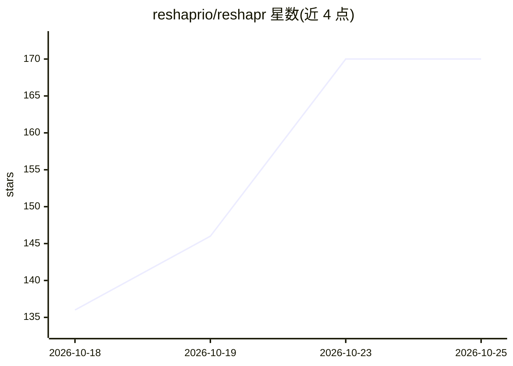

# reshaprio/reshapr

⭐ 170 · Java · Apache-2.0 · 推送 2026-10-25 · [GitHub](https://github.com/reshaprio/reshapr) · [官网](https://reshapr.io) · 组织维护

**将既有 REST/GraphQL/gRPC API 转为 MCP 工具的运行时**

面向开发者的开源运行时：导入既有 API 契约（如 OpenAPI 文件），自动生成可治理、可发现的 MCP 工具服务器，无需为每个 API 编写专属 MCP server。核心机制包括 Context Control（在载荷到达 LLM 前过滤与精简，减少 token 消耗）与多协议支持（REST、GraphQL、gRPC）。通过 npm 安装 CLI（需 Node.js），本地运行依赖 Docker（docker-compose 拉起容器，控制平面默认 localhost:5555，MCP 端点默认 localhost:7777），也提供 try.reshapr.io 在线沙箱。

## 筛选速览

| 维度 | 判定 | 备注 |
|---|---|---|
| AI 角色 | `ai-ecosystem` | LLM/agent 周边工具 |
| 许可风险 | `permissive` | Apache-2.0 |
| 部署形态 | `library` | 以包/库形式分发 |
| 模型依赖 | — | README 未给出锁定关系 |
| 硬件要求 | — | 无带数字的原话,不猜 |
| 安装摩擦 | `low` | 无编译、无系统依赖或容器化 |
| 成熟度 | — | 结构信号不足 |

## 能力要点

- 导入既有契约即生成 MCP 工具服务器，无需逐 API 编写 MCP server
- Context Control：在载荷到达 LLM 前过滤与精简
- 支持 REST、GraphQL、gRPC 多协议
- 提供在线沙箱 try.reshapr.io 与本地 docker-compose 两种运行方式

## 适用场景

- 把公司内部 REST/GraphQL/gRPC 服务接入 LLM 或 AI agent
- 为多个 API 统一暴露 MCP 工具端点
- 控制发送给 LLM 的响应体积以降低 token 消耗

## 场景标签

`Agent 框架` · 领域:Agent 开发

## 证据(README 行号)

> L17: **reShapr** is the open source runtime that turns your existing APIs AI-Native, without rebuilding them. It bridges
> L36: * AI-Native Transformation: Auto-transform API services into LLM-friendly tools.

## 星数曲线

2026-10-18 136 → 2026-10-25 170（+34）

---
*卡片 v1 · prompt 1.4 · 生成 2026-10-23 · 置信度 high · 依据 README sha `1941f504f7e0` · [字段定义](../../DATASET.md)*
