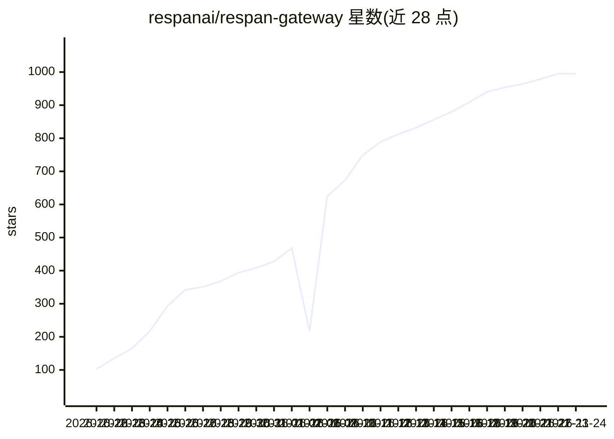

# respanai/respan-gateway

⭐ 1,019 · Rust · Apache-2.0 · 推送 2026-11-24 · [GitHub](https://github.com/respanai/respan-gateway) · [官网](https://respan.ai/ai-gateway) · 组织维护

**给开发者的统一 LLM 网关：一个端点接入多家 AI 厂商**

用 Rust 编写的开源 LLM 网关，以单一二进制形式部署在应用代码与各 AI API 之间：用户沿用现有 SDK 指向网关，即可调用各家聊天、图像、语音、视频与嵌入模型，四种 API 格式（OpenAI Chat/Responses、Anthropic Messages、Gemini）之间互相翻译。内置路由、fallback、重试、hedged 请求等流量控制，实时请求日志记录成本与延迟，支持 MCP 服务器与内置工具，全部功能以 Rust 插件形式提供。安装方式包括 pip、cargo、GitHub release、Docker 及嵌入 Python/Rust 进程。

## 筛选速览

| 维度 | 判定 | 备注 |
|---|---|---|
| AI 角色 | `ai-ecosystem` | LLM/agent 周边工具 |
| 许可风险 | `permissive` | Apache-2.0 |
| 部署形态 | `self-host` | docker 或自建部署 |
| 模型依赖 | local-ok | 支持本地模型 |
| 硬件要求 | — | 无带数字的原话,不猜 |
| 安装摩擦 | `low` | 无编译、无系统依赖或容器化 |
| 成熟度 | — | 结构信号不足 |

## 能力要点

- 单二进制网关，任何 SDK 指向它即可调用任意厂商模型
- 四种 API 格式互译，跨厂商实时语音互通
- 内置路由/fallback/重试/hedged 请求与带成本延迟的实时请求日志
- 全部功能基于一个公共 Rust trait 的插件体系，支持自写插件

## 适用场景

- 用现有 OpenAI 或 Anthropic SDK 调用其他厂商的模型
- 为多模型应用配置 fallback、重试与成本优先路由
- 通过网关让普通聊天模型调用 MCP 服务器与搜索、代码沙箱等工具
- 集中记录各调用成本、延迟与 token 用量

## 场景标签

`模型网关` · 领域:Agent 开发

## 证据(README 行号)

> L16: **Respan Gateway** is an open-source LLM gateway: a single Rust binary that sits between your code and
> L31:  OpenAI Chat Completions, OpenAI Responses, Anthropic Messages and Gemini API

## 星数曲线

2026-10-22 103 → 2026-11-24 995（+892）

---
*卡片 v1 · prompt 1.4 · 生成 2026-11-24 · 置信度 high · 依据 README sha `c7af0425f05c` · [字段定义](../../DATASET.md)*
