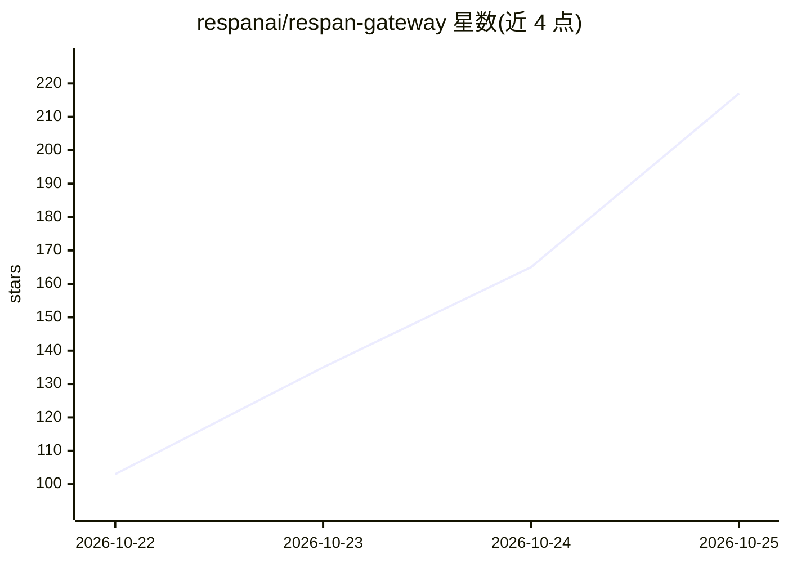

# respanai/respan-gateway

⭐ 293 · Rust · Apache-2.0 · 推送 2026-10-25 · [GitHub](https://github.com/respanai/respan-gateway) · [官网](https://respan.ai) · 组织维护

**统一接入各家 LLM API 的 Rust 网关：任意 SDK 调任意模型**

单个 Rust 二进制形式的 LLM 网关，部署在应用代码与各家 AI API 之间：OpenAI/Anthropic/Gemini 等客户端格式经其翻译后可调用任一供应商的聊天、图像、语音、转录、嵌入与视频模型；内置 MCP 工具路由、命名路由、回退、重试与对冲请求等流量控制，并提供实时请求日志与成本、延迟、token 统计。无需配置文件即可启动，检测到密钥的供应商自动接入。面向需要统一多供应商接入与流量治理的开发者；所有功能以公共 Rust 插件 API 实现，可自定义扩展。

## 筛选速览

| 维度 | 判定 | 备注 |
|---|---|---|
| AI 角色 | `ai-ecosystem` | LLM/agent 周边工具 |
| 许可风险 | `permissive` | Apache-2.0 |
| 部署形态 | `library` | 以包/库形式分发 |
| 模型依赖 | local-ok | 支持本地模型 |
| 硬件要求 | — | 无带数字的原话,不猜 |
| 安装摩擦 | `low` | 无编译、无系统依赖或容器化 |
| 成熟度 | — | 结构信号不足 |

## 能力要点

- 四种客户端 API 格式间的相互翻译，可调用任一供应商模型
- MCP 服务器与内置工具可被任意模型在聊天请求中调用
- 命名路由、回退、重试、对冲请求等流量控制与实时请求日志
- 公共 Rust 插件 API，功能均以插件实现，支持自定义

## 适用场景

- 用现有 OpenAI/Anthropic SDK 统一调用多家供应商的模型
- 在网关层做模型回退、重试与按成本/速度选择供应商
- 让任意模型在聊天请求中使用 MCP 工具与代码沙箱
- 查看每次调用的成本、延迟与 token 日志

## 场景标签

`模型网关` · 领域:Agent 开发

## 证据(README 行号)

> L15: **Respan Gateway** is a single Rust binary that sits between your code and
> L16: every AI API. Point the SDK you already use at it, and it connects you to
> L27:  OpenAI Chat Completions, OpenAI Responses, Anthropic Messages and Gemini API

## 星数曲线

2026-10-22 103 → 2026-10-25 217（+114）

---
*卡片 v1 · prompt 1.4 · 生成 2026-10-23 · 置信度 high · 依据 README sha `644770bf7abe` · [字段定义](../../DATASET.md)*
