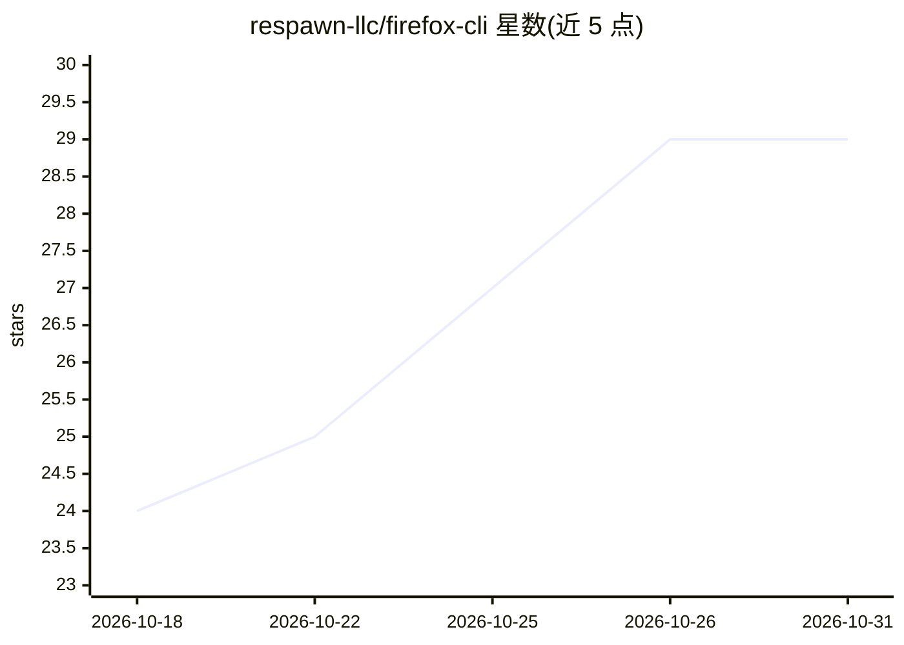

# respawn-llc/firefox-cli

⭐ 29 · TypeScript · AGPL-3.0 · 推送 2026-10-22 · [GitHub](https://github.com/respawn-llc/firefox-cli) · 组织维护

**让 AI Agent 通过 CLI 控制真实 Firefox 浏览器**

npm 全局安装的 CLI 工具，配合一个 Firefox 扩展与原生宿主通信，使编码类 AI agent 能以用户真实已认证会话操作浏览器：导航、管理标签页与窗口、读取元素与浏览器状态、截图、观察日志与网络活动，并串行执行浏览器工作流。安装流程含原生宿主注册、扩展安装与连接批准三步，`doctor` 命令诊断并修复注册状态。附带 Claude Code 插件与 Codex 技能安装途径。安全上，批准扩展即授予对已登录站点、Cookie 与敏感数据的完全控制。Firefox 下存在私有窗口只读、跨域 iframe 仅诊断等限制。

## 筛选速览

| 维度 | 判定 | 备注 |
|---|---|---|
| AI 角色 | `ai-ecosystem` | LLM/agent 周边工具 |
| 许可风险 | `viral` | AGPL-3.0 |
| 部署形态 | `library` | 以包/库形式分发 |
| 模型依赖 | — | README 未给出锁定关系 |
| 硬件要求 | — | 无带数字的原话,不猜 |
| 安装摩擦 | `low` | 无编译、无系统依赖或容器化 |
| 成熟度 | — | 结构信号不足 |

## 能力要点

- CLI + Firefox 扩展 + 原生宿主架构，操作真实已认证用户会话
- 覆盖导航、标签/窗口管理、元素交互、截图、网络与日志观察
- 提供 Claude Code 插件、Codex 技能与 skills.sh 三种 agent 技能安装途径
- `doctor --fix` 诊断并修复安装注册问题

## 适用场景

- 让编码 agent 在真实登录会话下自动化网页操作与表单填写
- Web 开发中由 agent 检查页面、观察网络与控制台日志
- 跨 CLI 工作流串行执行浏览器操作并截图取证

## 场景标签

`浏览器自动化` · 领域:效率与自动化

## 证据(README 行号)

> L1: `firefox-cli` gives AI agents terminal-driven **control over a user's Firefox** browser.
> L33: Install the agent skill so coding agents know when `firefox-cli` is available and how to use it.

## 星数曲线

2026-10-18 24 → 2026-10-31 29（+5）

---
*卡片 v1 · prompt 1.4 · 生成 2026-10-26 · 置信度 high · 依据 README sha `b52dc2a7cd6d` · [字段定义](../../DATASET.md)*
