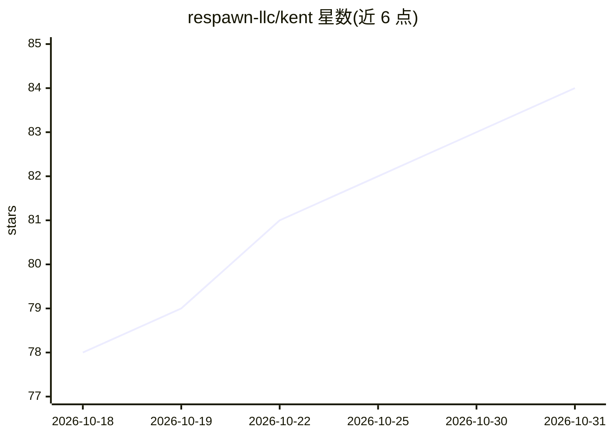

# respawn-llc/kent

⭐ 84 · Go · AGPL-3.0 · 推送 2026-10-30 · [GitHub](https://github.com/respawn-llc/kent) · [官网](https://kent.sh) · 组织维护

**面向专业工程师的终端编码 Agent，主打长任务输出质量**

Kent 是运行于终端的编码 agent 框架，为专业软件工程师设计，聚焦长时运行任务与输出质量。核心机制包括：模型自主决定的多步 compaction 算法、并行运行的可定制 supervisor agent 审查主 agent 的改动、基于异步 shell 与 0-token ralph loop 的子代理、仅三个内置工具（patch/shell/ask）的 token 优化设计，以及 Git worktrees 并行运行 10+ agent。服务器进程可隔离运行（如 Docker），通过 .toml 文件共享团队配置。明确不支持 MCP、Plan mode 与 WebFetch，不支持 Anthropic/Gemini 订阅通道，已支持 OpenAI Responses 兼容 API、本地模型与 OpenAI API key。

## 筛选速览

| 维度 | 判定 | 备注 |
|---|---|---|
| AI 角色 | `ai-native` | 本体是模型或模型工具 |
| 许可风险 | `viral` | AGPL-3.0 |
| 部署形态 | `None` |  |
| 模型依赖 | — | README 未给出锁定关系 |
| 硬件要求 | — | 无带数字的原话,不猜 |
| 安装摩擦 | `low` | 无编译、无系统依赖或容器化 |
| 成熟度 | — | 结构信号不足 |

## 能力要点

- 模型自主决定 compaction 时机与内容的多步算法，宣称可承受 35+ 次压缩
- 并行 supervisor agent 审查主 agent 改动并引导其遵循指令
- 仅 patch/shell/ask 三个内置工具，工具异步运行，宣称 1.6-2x token 节省
- Git worktrees 一等支持，可自动管理并行运行 10+ agent

## 适用场景

- 在大型代码库上让 agent 长时间安全地执行重构或编码任务
- 通过子代理与 supervisor 组合完成多角色协作的编码工作流
- 团队通过 .toml 配置文件共享 per-project 提示词与技能包

## 场景标签

`编码 Agent` `Agent 框架` · 领域:Agent 开发

## 证据(README 行号)

> L3:  Kent is a high-performance coding agent for professional Agentic Engineers focusing on output quality and long-runn
> L11: Kent is a coding agent for professional engineers. It gives frontier coding models the features that empower them t
> L31: - Kent runs a **customizable supervisor agent** in parallel with the main agent. The supervisor reviews the agent's

## 星数曲线

2026-10-18 78 → 2026-10-31 84（+6）

---
*卡片 v1 · prompt 1.4 · 生成 2026-10-24 · 置信度 high · 依据 README sha `fa9336ec4afe` · [字段定义](../../DATASET.md)*
